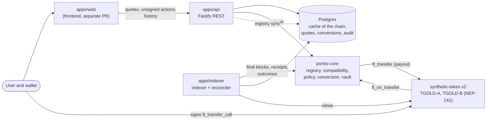
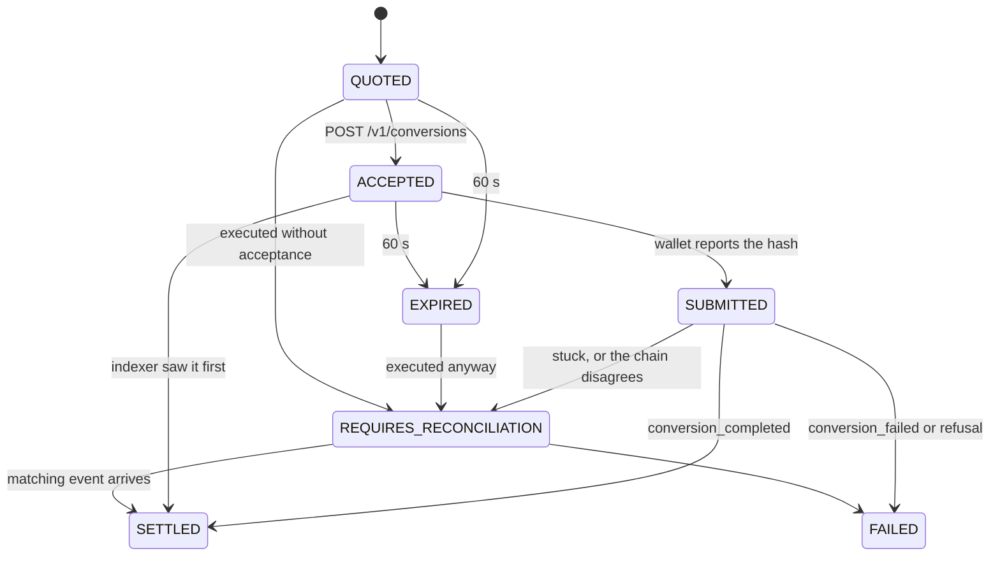

# Architecture overview

Pontis converts one synthetic test representation into another at a reviewed, fixed parity ratio on NEAR Testnet. It is a **parity conversion of synthetic assets from a controlled test vault**: not a bridge, not an exchange, and nothing here is backed or verified. See [what is mocked](deliberately-mocked.md) and the [known limitations](../known-limitations.md).

## Components



| Part                                | Responsibility                                                                                                                                       | Holds                                         |
| ----------------------------------- | ---------------------------------------------------------------------------------------------------------------------------------------------------- | --------------------------------------------- |
| `contracts/pontis-core`             | Registry, compatibility reviews, transfer policy and allowlist, quote verification, conversion execution, vault inventory, roles, pause, events      | The authority on what may convert             |
| `contracts/synthetic-token`         | NEP-141 test tokens with owner mint and a testnet faucet                                                                                             | Balances                                      |
| `apps/api`                          | Serves the catalog, compares routes, signs quotes, accepts them idempotently, returns **unsigned** wallet actions, serves history and the admin view | The quote-signer key (env only), no user keys |
| `apps/indexer`                      | Follows final blocks for `pontis-core` receipts, stores events, settles quotes; the reconciler checks the database against the chain                 | Nothing secret                                |
| `packages/domain`, `api-types`, ... | Shared types, the API contract (Zod to OpenAPI), the NEAR client, the quote math and signing shared with the contract through test vectors           | -                                             |
| `scripts/`                          | Deploy, seed, allowlist, operator commands                                                                                                           | The deployer key, on the operator's machine   |

## Converting, end to end

```mermaid
sequenceDiagram
    participant W as Wallet
    participant A as API
    participant S as Token A
    participant C as pontis-core
    participant B as Token B
    participant I as Indexer
    W->>A: POST /v1/quotes
    A->>C: views: route gate, allowlist, inventory, fee
    A-->>W: signed quote, 60 s
    W->>A: POST /v1/conversions (Idempotency-Key)
    A-->>W: unsigned actions (storage_deposit, ft_transfer_call)
    W->>B: storage_deposit (if not registered)
    W->>S: ft_transfer_call(core, amount, msg = quote + signature)
    S->>C: ft_on_transfer
    Note over C: verifies signature, expiry, versions, route gate,<br/>allowlist, inventory; marks the nonce used
    C->>B: ft_transfer(user, net)
    C-->>S: 0 unused, or the whole input if refused
    W->>A: POST /v1/conversions/{id}/submitted (optional)
    I->>C: final block receipts
    I->>I: conversion_completed, so the quote is SETTLED
```

The route gate runs twice: when the API quotes and again inside `ft_on_transfer`. A conversion executes only for an approved `DIRECT_EQUIVALENT` pair between active, unpaused assets, whatever the API said earlier. Any refusal returns the whole input to the user and emits `conversion_rejected` with the reason.

## Quote lifecycle



The indexer, not the wallet, is what settles a quote: an `ACCEPTED` quote the chain already executed passes through `SUBMITTED` on its way. The decisions behind each arrow are in [ADR 0007](../decisions/0007-conversion-via-ft-transfer-call.md), [0011](../decisions/0011-indexer.md) and [0012](../decisions/0012-reconciliation.md).

## Trust boundaries

- **The chain is the authority.** Postgres is a cache of registry state and a record of quotes and events. It can be dropped and rebuilt by the sync and the indexer, except quotes, conversions and the audit log.
- **The API signs quotes and nothing else.** It never holds a user key or a role key. A stolen quote-signer key lets an attacker sign quotes that the contract would honour at the ratio and fee it enforces, so the contract re-checks everything it can ([threat model](../threat-model/mvp.md), T1, T3 and T30).
- **Roles are on chain.** Owner, registrar, compatibility approver and pauser are accounts; the operator runs their commands through `scripts/ops.ts` and `scripts/allowlist.ts` ([ADR 0003](../decisions/0003-admin-roles-and-pause.md)).
- **Admin reads are authenticated and audited** ([ADR 0013](../decisions/0013-api-hardening.md)).

## Where to look

| Question                        | Place                                                          |
| ------------------------------- | -------------------------------------------------------------- |
| Why was it built this way?      | [`docs/decisions/`](../decisions/README.md) (ADR 0001 to 0013) |
| What can go wrong?              | [`docs/threat-model/mvp.md`](../threat-model/mvp.md)           |
| What does the API return?       | `packages/api-types/openapi.yaml`, generated from the schemas  |
| How do I run it?                | [`docs/local-setup.md`](../local-setup.md)                     |
| How do I show it?               | [`docs/demo-script.md`](../demo-script.md)                     |
| Something is wrong in operation | [`docs/runbooks/`](../runbooks/README.md)                      |
| What is deployed?               | [`deployments.md`](deployments.md)                             |
