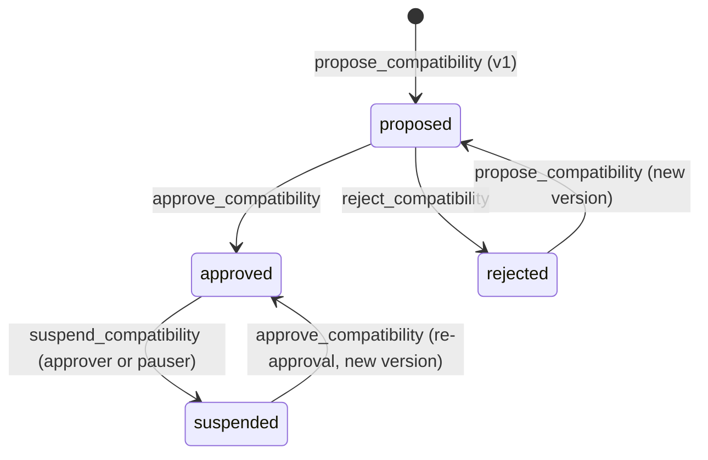

# ADR 0004: Compatibility and policy versioning

- **Status:** Accepted
- **Date:** 2026-11-07
- **Brief items:** §6.5–6.7, §7.4, §13.4, §19.2
- **Related:** [0001](0001-synthetic-claim-and-units.md), [0005](0005-allowlist-eligibility.md), [0006](0006-quote-signing-model.md)

## Context

A quote must be rejected if the compatibility or policy basis changed between quote and execution (brief §6.7, §7.4). Versions have to be coarse enough that harmless changes do not invalidate every outstanding quote, and fine enough that no material change slips through.

## Decision

### Compatibility

- One relationship per unordered pair of representations. Its ratio is stored in the direction `rep_a to rep_b`; the reverse direction uses the reciprocal.
- Fields: `classification`, `ratio {num, den}`, `scope`, `rationale`, evidence refs, `proposed_by`, `approved_by`, `status`, `version`, `updated_at`.
- Lifecycle: `proposed -> approved | rejected`, and `approved -> suspended`. A suspended relationship may be re-approved, which creates a **new version**.
- `version` is a `u64` that increases on every approval, suspension, re-approval and ratio, scope or classification change. Every version is appended to an **append-only history**; history entries are never edited or deleted.
- Only `DIRECT_EQUIVALENT` + status `approved` + both representations `active` and unpaused is usable for conversion. `ECONOMICALLY_SIMILAR`, `INCOMPATIBLE` and `SUSPENDED` never enable parity conversion.
- Staleness is handled operationally: a relationship whose evidence is stale is suspended by a `compat_approver` or `pauser`, effective immediately. The contract does not auto-expire relationships in the MVP.

### Policy

- Policy covers per-representation eligibility rules ([0005](0005-allowlist-eligibility.md)).
- `policy_version` is a single global `u64`. It increases when policy **rules** change (for example allowlist mode or limits). It does **not** increase when allowlist **membership** changes.
- Membership is checked live at execution, so adding or removing an account takes effect immediately without invalidating other users' quotes.

### Binding to quotes

A quote carries the relationship `version` and the global `policy_version` ([0006](0006-quote-signing-model.md)). `ft_on_transfer` rejects the quote unless both equal the current values. Status and pause flags are checked live, not versioned.

## Consequences

- Suspending a relationship both blocks new execution (status check) and invalidates old quotes (version bump).
- Re-approval after suspension requires a fresh quote.
- Contract storage grows with each version; acceptable for testnet.

## Alternatives considered

- _Bump `policy_version` on every allowlist edit:_ rejected; one onboarding would void all outstanding quotes.
- _Per-representation policy versions in the quote:_ rejected for the MVP; one global counter is enough and keeps the signed payload small.

## Amendments (B6, as implemented in `pontis-core`)

These refine the decision above without changing its intent.

- **Version counting.** `version` equals the length of the append-only history, so it moves on every recorded change, including the proposal (version 1) and a rejection, not only on approval, suspension and re-approval. A first approval therefore yields version 2.
- **Suspension sets the classification.** Suspending stores `classification = SUSPENDED` (brief §6.5) alongside `status = suspended`. Re-approval restores the classification of the last approved version. `SUSPENDED` cannot be proposed.
- **Who may act.** `compat_approver` proposes, approves, rejects and adds evidence. Suspension is also open to `pauser` and is not blocked by the global pause. A rejected relationship can be proposed again; its history and version count continue.
- **Approval checks.** Both representations must be `active`. Approving `DIRECT_EQUIVALENT` additionally needs at least one evidence reference and a ratio equal to `multiplier_a / multiplier_b` ([0001](0001-synthetic-claim-and-units.md)). Other classifications can be approved as a recorded review but never enable parity.
- **Pair keys.** A relationship is keyed `"{a}:{b}"` with `a < b`; the contract sorts the pair and inverts the ratio when the caller gave the other order.
- **Route gate.** `get_route(from, to)` and the internal `check_route` combine contract pause, both representations, their issuers and claims, and the relationship into one result: `RouteTerms` (ratio in the requested direction, `compatibility_version`, `policy_version`) or a `RouteRefusal`. The API maps refusals to its codes.
- **Policy.** The registrar (not a separate role) sets `allowlist_required` per representation, default `true`. Setting the value it already has is an error, so a no-op cannot bump `policy_version` and void quotes. `policy_version` starts at 1.

### Lifecycle as implemented

Every arrow appends one history entry and increments `version`. Only the `approved` state with classification `DIRECT_EQUIVALENT` is executable.
