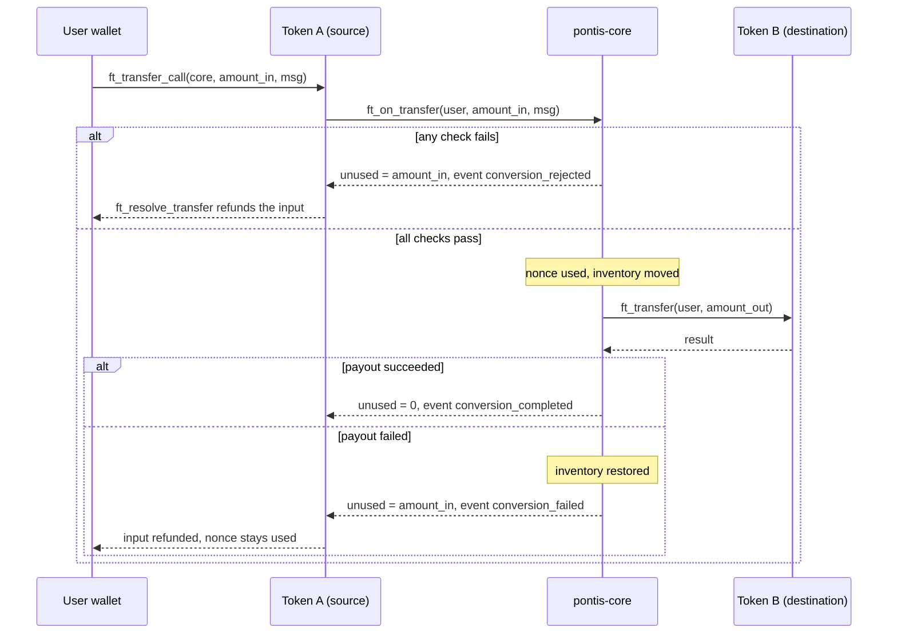

# ADR 0007: Conversion via `ft_transfer_call`

- **Status:** Accepted
- **Date:** 2026-11-07
- **Brief items:** §7.1, §13.2, §13.4, §15.2
- **Related:** [0006](0006-quote-signing-model.md), [0008](0008-vault-inventory-and-funding.md)

## Context

The conversion has to be atomic from the user's point of view: either they get the output and the input is taken, or they keep the input. NEP-141 gives a built-in pattern for this: `ft_transfer_call` followed by `ft_on_transfer`, with the receiver returning the unused amount.

## Decision

### Flow

1. The user's wallet calls `ft_transfer_call` on **token_in** with `receiver_id = pontis-core`, `amount = quote.amount_in`, `msg = {"quote": ..., "signature": ...}` (1 yoctoNEAR deposit).
2. The token moves the input to `pontis-core`, then calls `ft_on_transfer(sender_id, amount, msg)`.
3. `pontis-core` validates (all must pass, otherwise it returns the full `amount` as unused and emits `conversion_rejected`):
   1. `predecessor_account_id` is a registered, active representation (blocks fake tokens);
   2. `msg` parses; `msg == "fund_vault"` is handled by the vault path ([0008](0008-vault-inventory-and-funding.md));
   3. signature valid for the stored quote signer;
   4. `now_ms < expires_at_ms`;
   5. `sender_id == quote.user` and `predecessor == quote.token_in`;
   6. `amount == quote.amount_in`;
   7. compatibility version and policy version equal the current values;
   8. both representations `active` and not paused, global pause off, relationship `approved` + `DIRECT_EQUIVALENT`;
   9. user allowlisted where required;
   10. recomputed `gross`, `fee`, `net` equal the quote;
   11. inventory of `token_out` is at least `net`;
   12. nonce unused.
4. On success it records the nonce, moves inventory (`+amount_in` on token_in, `-net` on token_out) **before** creating the payout promise, then calls `ft_transfer(user, net)` on **token_out** with a callback.
5. The callback `on_payout_resolved` checks the promise result:
   - success: emit `conversion_completed` (full breakdown) and return `0` unused, so the token keeps the input as `pontis-core`'s balance;
   - failure: restore inventory, emit `conversion_failed`, and return `amount_in` unused so the token refunds the user. The nonce stays used.

### Notes

- **Storage on token_out.** If the user has no storage deposit on token_out the payout fails and the input is refunded. The API's unsigned transaction plan includes `storage_deposit` on token_out when needed ([BuildPlan B11](../../BuildPlan.md)).
- **Gas.** `ft_transfer_call` must attach enough gas for `ft_on_transfer`, the payout `ft_transfer`, the callback and the token's `ft_resolve_transfer`. The value is fixed during B7/B8 by measurement and returned in the unsigned plan.
- **No reentrancy window.** State changes precede promise creation; the callback only resolves outcomes and reverses the inventory move.
- **Exact amount.** `amount` must equal `quote.amount_in`; over-sending is rejected and refunded rather than partly consumed.
- The user is always both sender and recipient.

## Consequences

- Validation is synchronous with the transfer; there is no approval step and no allowance to abuse.
- Every rejected or failed path ends with the user's input returned by the token's own refund logic, which the integration tests cover (BuildPlan B8).
- A paused `token_out` contract fails the payout and triggers the refund path rather than losing funds.

## Alternatives considered

- _`ft_transfer` then a separate `convert` call:_ rejected; two transactions allow input to be stranded between them.
- _`storage_deposit` + `ft_transfer_call` combined by the contract:_ rejected; wallet transaction plans already batch actions, so no contract support is needed.

## Amendments (B7)

Validation order as implemented (the first failure wins and returns the whole input): registered token, parseable message, signature, quote `version` and `contract`, expiry (`now >= expires_at_ms` is expired), sender equals user, token equals `token_in`, `token_out` registered, exact amount, route (suspended, paused or inactive, not parity), compatibility version, policy version, fee, allowlist for both representations, recomputed amounts, non-zero output, inventory, unused nonce.

| `conversion_rejected.reason`                                                                                                                                    | API error code (B10)                                |
| --------------------------------------------------------------------------------------------------------------------------------------------------------------- | --------------------------------------------------- |
| `QUOTE_EXPIRED`                                                                                                                                                 | `QUOTE_EXPIRED`                                     |
| `NONCE_USED`                                                                                                                                                    | `QUOTE_ALREADY_USED`                                |
| `NOT_ELIGIBLE`, `INSUFFICIENT_INVENTORY`, `ASSET_PAUSED`, `RELATIONSHIP_SUSPENDED`, `NOT_DIRECT_EQUIVALENT`                                                     | same name                                           |
| `UNKNOWN_TOKEN`, `INVALID_MSG`, `BAD_SIGNATURE`, `SIGNER_NOT_SET`, `UNSUPPORTED_VERSION`, `CONTRACT_MISMATCH`, `WRONG_SENDER`, `WRONG_TOKEN`, `AMOUNT_MISMATCH` | `VALIDATION_ERROR`                                  |
| `COMPATIBILITY_CHANGED`, `POLICY_CHANGED`, `FEE_CHANGED`, `OUTPUT_MISMATCH`, `AMOUNT_TOO_SMALL`, `INVENTORY_OVERFLOW`, `NOT_OWNER`                              | `INTERNAL` (stale or unexpected; the API re-quotes) |

- A conversion whose output rounds to zero is refused (`AMOUNT_TOO_SMALL`) rather than taking the input for nothing.
- Inventory and the nonce are updated before the payout promise is created. `on_payout_resolved` returns `0` on success and the whole `amount_in` on failure, after restoring inventory.

### Flow as implemented

Both outcomes of the payout leave the user with either the output or the original input, never neither; the sandbox tests in B8 exercise the real token and refund logic.
