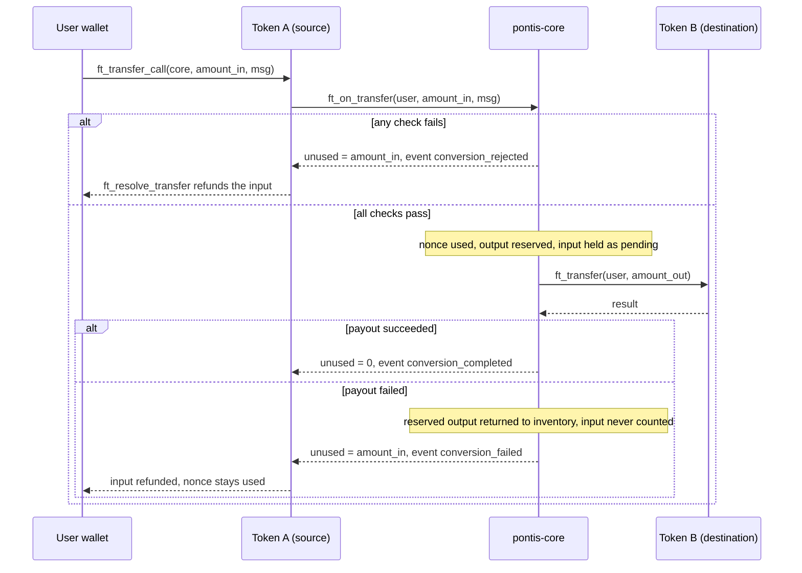

# ADR 0007: Conversion via `ft_transfer_call`

- **Status:** Accepted
- **Date:** 2026-11-07
- **Brief items:** §7.1, §13.2, §13.4, §15.2
- **Related:** [0006](0006-quote-signing-model.md), [0008](0008-vault-inventory-and-funding.md)

## Context

The conversion has to be safe from the user's point of view: either they get the output and the input is taken, or they keep the input. This is not an atomic transaction: it spans several NEAR receipts (the token's transfer, `ft_on_transfer`, the payout, the callback and the token's resolver) and relies on a compensating refund. NEP-141 gives a built-in pattern for this: `ft_transfer_call` followed by `ft_on_transfer`, with the receiver returning the unused amount.

## Decision

### Flow

1. The user's wallet calls `ft_transfer_call` on **token_in** with `receiver_id = pontis-core`, `amount = quote.amount_in`, `msg = {"quote": ..., "signature": ...}` (1 yoctoNEAR deposit).
2. The token moves the input to `pontis-core`, then calls `ft_on_transfer(sender_id, amount, msg)`.
3. `pontis-core` validates (all must pass, otherwise it returns the full `amount` as unused and emits `conversion_rejected`):
   1. `predecessor_account_id` is a registered, active representation (blocks fake tokens);
   2. `msg` parses; `msg == "fund_vault"` is handled by the vault path ([0008](0008-vault-inventory-and-funding.md));
   3. signature valid for the stored quote signer;
   4. `now_ms < expires_at_ms`;
   5. `sender_id == quote.user` and `predecessor == quote.token_in`;
   6. `amount == quote.amount_in`;
   7. compatibility version and policy version equal the current values;
   8. both representations `active` and not paused, global pause off, relationship `approved` + `DIRECT_EQUIVALENT`;
   9. user allowlisted where required;
   10. recomputed `gross`, `fee`, `net` equal the quote;
   11. inventory of `token_out` is at least `net`;
   12. nonce unused.
4. On success it records the nonce, reserves the output (`-net` on token_out inventory) and holds the input as pending (`+amount_in` on `pending_inbound[token_in]`, not on inventory) **before** creating the payout promise, then calls `ft_transfer(user, net)` on **token_out** with a callback.
5. The callback `on_payout_resolved` checks the promise result:
   - success: emit `conversion_completed` (full breakdown), move the input into spendable inventory, and return `0` unused, so the token keeps the input as `pontis-core`'s balance;
   - failure: return the reserved output to inventory, emit `conversion_failed`, and return `amount_in` unused so the token refunds the user. The nonce stays used.

### Notes

- **Storage on token_out.** If the user has no storage deposit on token_out the payout fails and the input is refunded. The API's unsigned transaction plan includes `storage_deposit` on token_out when needed ([BuildPlan B11](../../BuildPlan.md)).
- **Gas.** `ft_transfer_call` must attach enough gas for `ft_on_transfer`, the payout `ft_transfer`, the callback and the token's `ft_resolve_transfer`. The value is fixed during B7/B8 by measurement and returned in the unsigned plan.
- **Interleaving.** The payout and the callback are separate receipts, so other calls can run between them. That is why the input is held as pending, not spendable, until the callback (see the amendment on pending input).
- **Exact amount.** `amount` must equal `quote.amount_in`; over-sending is rejected and refunded rather than partly consumed.
- The user is always both sender and recipient.

## Consequences

- Validation is synchronous with the transfer; there is no approval step and no allowance to abuse.
- Every rejected or failed path ends with the user's input returned by the token's own refund logic, which the integration tests cover (BuildPlan B8).
- A paused `token_out` contract fails the payout and triggers the refund path rather than losing funds.

## Alternatives considered

- _`ft_transfer` then a separate `convert` call:_ rejected; two transactions allow input to be stranded between them.
- _`storage_deposit` + `ft_transfer_call` combined by the contract:_ rejected; wallet transaction plans already batch actions, so no contract support is needed.

## Amendments (B7)

Validation order as implemented (the first failure wins and returns the whole input): registered token, parseable message, signature, quote `version` and `contract`, expiry (`now >= expires_at_ms` is expired), sender equals user, token equals `token_in`, `token_out` registered, exact amount, route (suspended, paused or inactive, not parity), compatibility version, policy version, fee, allowlist for both representations, recomputed amounts, non-zero output, inventory, unused nonce.

| `conversion_rejected.reason`                                                                                                                                    | API error code (B10)                                |
| --------------------------------------------------------------------------------------------------------------------------------------------------------------- | --------------------------------------------------- |
| `QUOTE_EXPIRED`                                                                                                                                                 | `QUOTE_EXPIRED`                                     |
| `NONCE_USED`                                                                                                                                                    | `QUOTE_ALREADY_USED`                                |
| `NOT_ELIGIBLE`, `INSUFFICIENT_INVENTORY`, `ASSET_PAUSED`, `RELATIONSHIP_SUSPENDED`, `NOT_DIRECT_EQUIVALENT`                                                     | same name                                           |
| `UNKNOWN_TOKEN`, `INVALID_MSG`, `BAD_SIGNATURE`, `SIGNER_NOT_SET`, `UNSUPPORTED_VERSION`, `CONTRACT_MISMATCH`, `WRONG_SENDER`, `WRONG_TOKEN`, `AMOUNT_MISMATCH` | `VALIDATION_ERROR`                                  |
| `COMPATIBILITY_CHANGED`, `POLICY_CHANGED`, `FEE_CHANGED`, `OUTPUT_MISMATCH`, `AMOUNT_TOO_SMALL`, `INVENTORY_OVERFLOW`, `NOT_OWNER`                              | `INTERNAL` (stale or unexpected; the API re-quotes) |

- A conversion whose output rounds to zero is refused (`AMOUNT_TOO_SMALL`) rather than taking the input for nothing.
- The nonce is marked used, the output is reserved and the input is held as pending before the payout promise is created. `on_payout_resolved` returns `0` on success (the input becomes inventory) and the whole `amount_in` on failure (the reserved output returns to inventory; the input is never counted).

### Flow as implemented

Both outcomes of the payout leave the user with either the output or the original input. That is a compensating refund over several receipts, not an atomic transaction: see the amendment below for the window in which the payout is pending.

## Amendment (pending input)

**Defect fixed.** The first implementation added `amount_in` to the source representation's spendable inventory in `ft_on_transfer`, before the payout had resolved. In that window another conversion or an owner `withdraw_inventory` could spend tokens that still belonged to the user. If the payout then failed, `on_payout_resolved` returned `amount_in` as unused, but the token's `ft_resolve_transfer` refunds only `min(unused, balance of pontis-core)`, so the refund came back short (or empty) and the contract carried an inventory deficit.

**Design.**

- `inventory[rep]` is spendable inventory only. A new per-representation counter `pending_inbound[rep]` holds the inputs of conversions whose payout has not resolved. `get_pending_inbound` exposes it. The token balance of `pontis-core` for a representation is `inventory + pending_inbound` (plus any untracked surplus).
- `execute_conversion` marks the nonce used, takes `net` out of `token_out` inventory (reserving it for the payout), adds `amount_in` to `pending_inbound[token_in]`, and stores a `ConversionRecord` under the nonce in `pending_conversions` (`get_pending_conversion` reads it). It rejects with `INVENTORY_OVERFLOW` if `inventory + pending_inbound + amount_in` would overflow `u128`, so settlement cannot overflow later.
- `on_payout_resolved(nonce)` removes the pending record, releases `pending_inbound`, and then:
  - success: `amount_in` moves into spendable inventory; emits `conversion_completed`; returns `0`;
  - failure: the reserved `net` returns to `token_out` inventory; `amount_in` is **not** added to inventory, it stays in the token balance untouched until `ft_resolve_transfer` refunds it; emits `conversion_failed`; returns `amount_in`.
- A callback for a nonce with no pending record aborts without changing state. Arithmetic on inventory and pending counters is checked and aborts on overflow or underflow; nothing saturates.
- Withdrawals, `fund_vault` and other conversions see only spendable inventory, so they cannot consume a held input or an output reserved for an in-flight payout.

**Verification.** `contracts/integration-tests/tests/pending_inventory.rs` holds a destination payout open on a fixture token (`contracts/mock-payout-token`, test-only) and, while it is pending, attempts a withdrawal and a reverse conversion, then fails or succeeds the payout through the real `on_payout_resolved` and the real token's `ft_resolve_transfer`.

## Amendments (B11, the unsigned wallet plan)

`POST /v1/conversions` accepts a quote and returns the actions the user's wallet signs. The backend never signs for users.

- **Actions.** `ft_transfer_call` on the source token with exactly 1 yoctoNEAR and 100 Tgas, whose `msg` is `{"quote": ..., "signature": "<base64>"}` as the contract expects. If the user is not registered on the destination token (`storage_balance_of` is null) a `storage_deposit` with `registration_only` comes first, because a payout to an unregistered account fails and refunds the input. Each action has a single receiver, so a wallet sends them as separate transactions, in order.
- **Idempotency.** The `Idempotency-Key` header is required. The same key and quote return the stored plan unchanged, even if on-chain registration changed since. The same key for another quote is a `400`; a second key for an accepted quote is `409 QUOTE_ALREADY_USED`; an expired quote is `410 QUOTE_EXPIRED`. Acceptance (`QUOTED` to `ACCEPTED`) and the conversion row are one transaction, and concurrent requests resolve to a single winner.
- **Reporting the hash.** `POST /v1/conversions/{id}/submitted` moves `ACCEPTED` to `SUBMITTED`. The same hash again is a no-op; a different hash is `409`. A hash reported after the quote expired is `410`: the chain is authoritative, and the indexer (B12) reconciles by nonce, so nothing settles unseen.
- **Verified end to end.** On a local sandbox, a user not registered on TGOLD-B executed the returned plan (storage deposit, then transfer call) and received exactly 999,000,000 of TGOLD-B for 1,000,000 of TGOLD-A.
