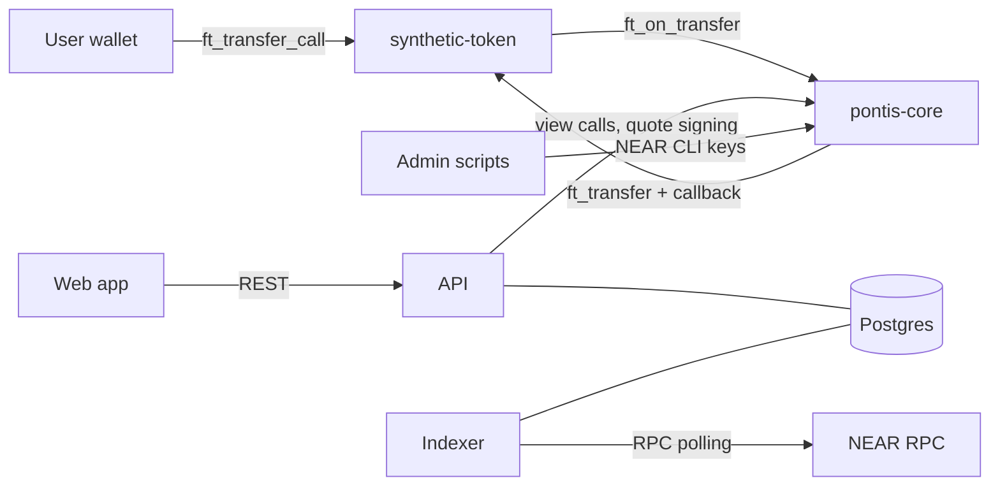

# MVP threat model

- **Status:** Draft v1 (Phase 0 exit criterion, brief §18.3, §16.2)
- **Date:** 2026-11-07
- **Scope:** testnet MVP with synthetic assets only. Nothing here authorises use with real assets or funds; see [ADR 0010](../decisions/0010-deferred-scope.md).
- **Related:** [ADR 0002](../decisions/0002-contract-layout-and-events.md), [0003](../decisions/0003-admin-roles-and-pause.md), [0006](../decisions/0006-quote-signing-model.md), [0007](../decisions/0007-conversion-via-ft-transfer-call.md), [0008](../decisions/0008-vault-inventory-and-funding.md)

## 1. Assets to protect

| Asset                             | Why it matters                                                        |
| --------------------------------- | --------------------------------------------------------------------- |
| Vault inventory in `pontis-core`  | Pays out conversions. Drain is the main fund-loss path.               |
| User tokens in flight             | Held by `pontis-core` between `ft_on_transfer` and payout resolution. |
| Compatibility and policy state    | Wrong approval means a false equivalence.                             |
| Quote-signer key                  | Authenticates quotes.                                                 |
| Admin and deployer keys           | Control roles, fees, withdrawal and redeploy.                         |
| Accounting integrity (events, DB) | History and reconciliation must match the chain.                      |
| Honest labelling                  | Users must not believe the assets are real or verified.               |

## 2. Actors and trust boundaries

| Boundary                 | Trust assumption                                                                                                                                              |
| ------------------------ | ------------------------------------------------------------------------------------------------------------------------------------------------------------- |
| User wallet to chain     | The user's wallet is the only authority over the user's tokens. The backend never holds user keys.                                                            |
| API to chain             | The API is trusted to run off-chain pre-checks and sign quotes, but **not** trusted for amounts, status or eligibility: the contract re-validates everything. |
| Web app to API           | Untrusted client. All input is validated.                                                                                                                     |
| Indexer to DB            | Trusted to apply chain events faithfully; the DB is a cache of the chain, never the authority.                                                                |
| Admin scripts            | Run by the operator with NEAR CLI credentials outside the API.                                                                                                |
| NEAR RPC                 | A single RPC provider may lie, lag or fail; finality window and re-scans mitigate.                                                                            |
| Synthetic token contract | Trusted only through the registry; `pontis-core` accepts `ft_on_transfer` only from registered active representations.                                        |

## 3. Threats and mitigations

Severity is for the MVP's testnet context. "Residual" is what remains after the planned mitigation.

| #   | Threat                                                                                    | Sev  | Mitigation                                                                                                                                                                                                    | Residual                                                                                                                  |
| --- | ----------------------------------------------------------------------------------------- | ---- | ------------------------------------------------------------------------------------------------------------------------------------------------------------------------------------------------------------- | ------------------------------------------------------------------------------------------------------------------------- |
| T1  | **Quote-signer compromise.** Attacker signs quotes freely.                                | Med  | Contract recomputes amounts and re-checks status, pauses, allowlist, inventory ([ADR 0006](../decisions/0006-quote-signing-model.md)). Rotate with `set_quote_signer`. Key only in env, never in git or logs. | Attacker can authorise valid conversions without API pre-checks and rate limits. Cannot exceed ratio or spend user funds. |
| T2  | **Quote replay.** Reuse a signed quote.                                                   | High | Nonce / operation ID marked used before payout and kept used after failure. Contract account, user, tokens and expiry are in the signed payload.                                                              | Nonce set grows without pruning (testnet only).                                                                           |
| T3  | **Altered quote.** User edits amounts or fee in `msg`.                                    | High | Signature covers every field; contract also recomputes output.                                                                                                                                                | None expected; covered by negative tests.                                                                                 |
| T4  | **Expired quote executed.**                                                               | High | `now_ms < expires_at_ms` enforced in `ft_on_transfer`. API sets 60 s expiry.                                                                                                                                  | Validator clock skew of seconds.                                                                                          |
| T5  | **Vault drain by rounding or dust splitting.**                                            | High | `floor` on gross, `ceil` on fee; `net <= gross <= exact`. Property tests for the invariant ([ADR 0001](../decisions/0001-synthetic-claim-and-units.md)). Checked arithmetic.                                  | None expected.                                                                                                            |
| T6  | **Vault drain by admin key.** Owner withdraws inventory.                                  | High | Owner-only, evented, visible to reconciler.                                                                                                                                                                   | Single owner key on testnet. Multisig is a precondition for non-testnet use.                                              |
| T7  | **Fake token calls `ft_on_transfer`.**                                                    | High | `predecessor_account_id` must be a registered active representation.                                                                                                                                          | None expected.                                                                                                            |
| T8  | **Unauthorised credit to vault inventory.**                                               | Med  | `fund_vault` honoured only for `owner`; other senders refunded. Plain `ft_transfer` is not credited and is flagged by reconciliation.                                                                         | Stranded tokens until owner recovery.                                                                                     |
| T9  | **Stale or wrong compatibility.** False equivalence, or relationship should be suspended. | High | Quote- and execution-time checks of status and `version`. Suspension is immediate by `pauser` or `compat_approver`. History is append-only.                                                                   | Staleness is not auto-detected; relies on operator review.                                                                |
| T10 | **Compatibility approved by the same account that proposed it.**                          | Med  | Both accounts recorded in history.                                                                                                                                                                            | Not enforced on-chain ([ADR 0003](../decisions/0003-admin-roles-and-pause.md)); accepted for testnet.                     |
| T11 | **Ratio typo at approval.**                                                               | High | Contract rejects an approved ratio that differs from the multiplier-derived ratio.                                                                                                                            | Multiplier itself could be wrong; checked by dossier review.                                                              |
| T12 | **Pause bypass.**                                                                         | High | Pause flags checked in every state-changing path; only `owner` unpauses.                                                                                                                                      | None expected.                                                                                                            |
| T13 | **Reentrancy / callback ordering.** State changed after a promise.                        | High | State, nonce and inventory are updated before promise creation; callback only reverses on failure.                                                                                                            | Cross-shard receipt ordering: integration tests on sandbox (B8).                                                          |
| T14 | **Payout fails after input taken.**                                                       | High | Callback restores inventory and returns `amount_in` unused so the token refunds the user; emits `conversion_failed`.                                                                                          | Token-level refund logic is trusted (NEP-141 standard).                                                                   |
| T15 | **Unregistered receiver storage on token_out.**                                           | Low  | Payout failure refunds input; API plan includes `storage_deposit`.                                                                                                                                            | Gas cost to user on failed attempt.                                                                                       |
| T16 | **Faucet abuse.** Mint spam.                                                              | Low  | Per-call cap and per-account cooldown; owner can disable.                                                                                                                                                     | Sybil accounts can still collect small amounts of worthless tokens. Faucet does not fund the vault.                       |
| T17 | **Eligibility bypass.**                                                                   | Med  | Allowlist checked at quote and live at execution.                                                                                                                                                             | Allowlist is not KYC ([ADR 0005](../decisions/0005-allowlist-eligibility.md)).                                            |
| T18 | **Indexer divergence.** Reorg, duplicate or missed events.                                | Med  | Unique on `(receipt_id, log_index)`, persisted cursor, finality-window re-scan, retry with backoff (B12).                                                                                                     | Brief display lag during RPC outages.                                                                                     |
| T19 | **API or DB tampering shows wrong state.**                                                | Med  | Chain is authoritative; reconciler compares DB, events and token balances and flags `REQUIRES_RECONCILIATION` (B13).                                                                                          | Operator must act on flags.                                                                                               |
| T20 | **API abuse.** Quote spam, brute force on admin endpoints.                                | Med  | Rate limiting, input validation, admin API key, CORS to the web origin (B14).                                                                                                                                 | Distributed abuse is out of scope for testnet.                                                                            |
| T21 | **Secret leakage via logs or errors.**                                                    | Med  | Log scrubbing; structured errors without internals; signer key and admin key only in env ([BuildPlan §11](../../BuildPlan.md)).                                                                               | Operator mistakes in env handling.                                                                                        |
| T22 | **Misleading UI.** Users believe assets are real, "verified" or bridged.                  | Med  | Synthetic and unverified flags are data ([ADR 0009](../decisions/0009-synthetic-evidence-labelling.md)); language rules enforced in review.                                                                   | None expected.                                                                                                            |
| T23 | **Wrong-network use.** User transacts on mainnet.                                         | Low  | Web network guard, testnet-only config, no mainnet contracts.                                                                                                                                                 | None expected.                                                                                                            |
| T24 | **Gas underestimate.** Callback fails to run, leaving state inconsistent.                 | Med  | Gas measured in sandbox tests and returned in the plan; reconciler flags stuck `SUBMITTED` quotes.                                                                                                            | Gas changes after protocol upgrades.                                                                                      |

## 4. Admin keys

| Key                                | Held by                                  | Used for                                                           | Controls                   |
| ---------------------------------- | ---------------------------------------- | ------------------------------------------------------------------ | -------------------------- |
| Owner / deployer                   | Operator, NEAR CLI credentials           | Roles, signer, fees, vault funding and withdrawal, unpause, deploy | Everything on the contract |
| Registrar, compat approver, pauser | Operator on testnet (may be one account) | Scripted admin actions                                             | Only their role            |
| Quote-signer                       | API environment                          | Signing quotes                                                     | Quote authenticity only    |
| Token owners (TGOLD-A, TGOLD-B)    | Operator                                 | Mint, burn, pause, faucet config                                   | Token supply               |

Rules: no key is stored in git; `.env*` and `.near-credentials` are ignored; the API holds only the quote-signer key; any non-testnet use requires multisig and key-lockdown design first.

## 5. Accepted MVP limitations

- Single operator may hold every role; proposer/approver separation not enforced on-chain.
- No automatic staleness expiry for relationships.
- Nonce set and relationship history are unpruned.
- No external audit, no formal verification, no production monitoring or backups.
- Testnet RPC and explorer availability are outside our control.

## 6. Verification plan

- Contract negative tests for T2–T4, T7–T8, T12, T14 (BuildPlan B6–B8).
- Property tests (proptest) for T5 using shared Rust and TypeScript vectors (B7, B10).
- Sandbox integration tests for T13–T14 (B8).
- Indexer tests for T18; reconciler injected-mismatch tests for T19 (B12–B13).
- API authorization and rate-limit tests for T20 (B14).
- This document is revisited at the end of B8 and again before B15.
