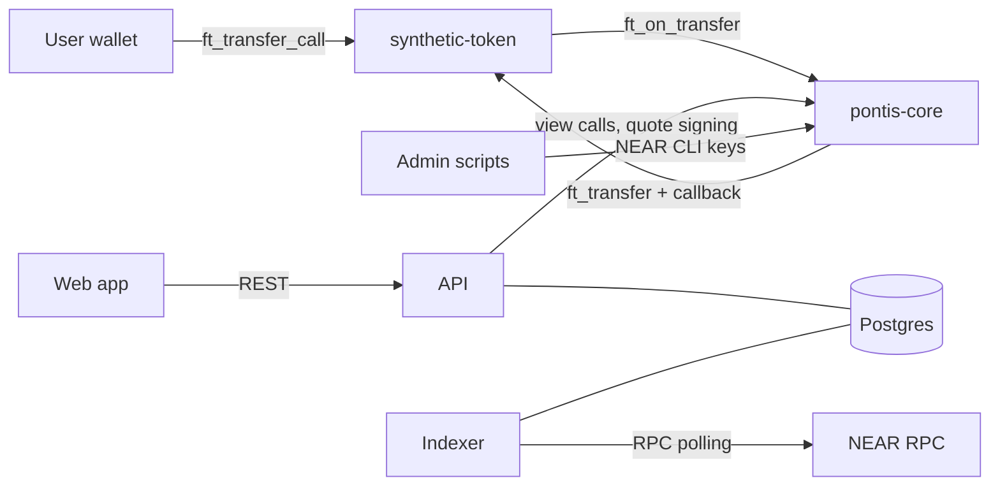

# MVP threat model

- **Status:** Draft v1 (Phase 0 exit criterion, brief §18.3, §16.2)
- **Date:** 2026-11-07
- **Scope:** testnet MVP with synthetic assets only. Nothing here authorises use with real assets or funds; see [ADR 0010](../decisions/0010-deferred-scope.md).
- **Related:** [ADR 0002](../decisions/0002-contract-layout-and-events.md), [0003](../decisions/0003-admin-roles-and-pause.md), [0006](../decisions/0006-quote-signing-model.md), [0007](../decisions/0007-conversion-via-ft-transfer-call.md), [0008](../decisions/0008-vault-inventory-and-funding.md)

## 1. Assets to protect

| Asset                             | Why it matters                                                        |
| --------------------------------- | --------------------------------------------------------------------- |
| Vault inventory in `pontis-core`  | Pays out conversions. Drain is the main fund-loss path.               |
| User tokens in flight             | Held by `pontis-core` between `ft_on_transfer` and payout resolution. |
| Compatibility and policy state    | Wrong approval means a false equivalence.                             |
| Quote-signer key                  | Authenticates quotes.                                                 |
| Admin and deployer keys           | Control roles, fees, withdrawal and redeploy.                         |
| Accounting integrity (events, DB) | History and reconciliation must match the chain.                      |
| Honest labelling                  | Users must not believe the assets are real or verified.               |

## 2. Actors and trust boundaries

| Boundary                 | Trust assumption                                                                                                                                              |
| ------------------------ | ------------------------------------------------------------------------------------------------------------------------------------------------------------- |
| User wallet to chain     | The user's wallet is the only authority over the user's tokens. The backend never holds user keys.                                                            |
| API to chain             | The API is trusted to run off-chain pre-checks and sign quotes, but **not** trusted for amounts, status or eligibility: the contract re-validates everything. |
| Web app to API           | Untrusted client. All input is validated.                                                                                                                     |
| Indexer to DB            | Trusted to apply chain events faithfully; the DB is a cache of the chain, never the authority.                                                                |
| Admin scripts            | Run by the operator with NEAR CLI credentials outside the API.                                                                                                |
| NEAR RPC                 | A single RPC provider may lie, lag or fail; finality window and re-scans mitigate.                                                                            |
| Synthetic token contract | Trusted only through the registry; `pontis-core` accepts `ft_on_transfer` only from registered active representations.                                        |

## 3. Threats and mitigations

Severity is for the MVP's testnet context. "Residual" is what remains after the planned mitigation.

| #    | Threat                                                                                                                                                                                                                                   | Sev    | Mitigation                                                                                                                                                                                                                                                                                                                                                                                                                                                                                                                                                                                                         | Residual                                                                                                                                                                                                           |
| ---- | ---------------------------------------------------------------------------------------------------------------------------------------------------------------------------------------------------------------------------------------- | ------ | ------------------------------------------------------------------------------------------------------------------------------------------------------------------------------------------------------------------------------------------------------------------------------------------------------------------------------------------------------------------------------------------------------------------------------------------------------------------------------------------------------------------------------------------------------------------------------------------------------------------ | ------------------------------------------------------------------------------------------------------------------------------------------------------------------------------------------------------------------ |
| T1   | **Quote-signer compromise.** Attacker signs quotes freely.                                                                                                                                                                               | Med    | Contract recomputes amounts and re-checks status, pauses, allowlist, inventory ([ADR 0006](../decisions/0006-quote-signing-model.md)). Rotate with `set_quote_signer`. Key only in env, never in git or logs.                                                                                                                                                                                                                                                                                                                                                                                                      | Attacker can authorise valid conversions without API pre-checks and rate limits. Cannot exceed ratio or spend user funds.                                                                                          |
| T2   | **Quote replay.** Reuse a signed quote.                                                                                                                                                                                                  | High   | Nonce / operation ID marked used before payout and kept used after failure. Contract account, user, tokens and expiry are in the signed payload.                                                                                                                                                                                                                                                                                                                                                                                                                                                                   | Nonce set grows without pruning (testnet only).                                                                                                                                                                    |
| T3   | **Altered quote.** User edits amounts or fee in `msg`.                                                                                                                                                                                   | High   | Signature covers every field; contract also recomputes output.                                                                                                                                                                                                                                                                                                                                                                                                                                                                                                                                                     | None expected; covered by negative tests.                                                                                                                                                                          |
| T4   | **Expired quote executed.**                                                                                                                                                                                                              | High   | `now_ms < expires_at_ms` enforced in `ft_on_transfer`. API sets 60 s expiry.                                                                                                                                                                                                                                                                                                                                                                                                                                                                                                                                       | Validator clock skew of seconds.                                                                                                                                                                                   |
| T5   | **Vault drain by rounding or dust splitting.**                                                                                                                                                                                           | High   | `floor` on gross, `ceil` on fee; `net <= gross <= exact`. Property tests for the invariant ([ADR 0001](../decisions/0001-synthetic-claim-and-units.md)). Checked arithmetic.                                                                                                                                                                                                                                                                                                                                                                                                                                       | None expected.                                                                                                                                                                                                     |
| T6   | **Vault drain by admin key.** Owner withdraws inventory.                                                                                                                                                                                 | High   | Owner-only, evented, visible to reconciler.                                                                                                                                                                                                                                                                                                                                                                                                                                                                                                                                                                        | Single owner key on testnet. Multisig is a precondition for non-testnet use.                                                                                                                                       |
| T7   | **Fake token calls `ft_on_transfer`.**                                                                                                                                                                                                   | High   | `predecessor_account_id` must be a registered active representation.                                                                                                                                                                                                                                                                                                                                                                                                                                                                                                                                               | None expected.                                                                                                                                                                                                     |
| T8   | **Unauthorised credit to vault inventory.**                                                                                                                                                                                              | Med    | `fund_vault` honoured only for `owner`; other senders refunded. Plain `ft_transfer` is not credited and is flagged by reconciliation.                                                                                                                                                                                                                                                                                                                                                                                                                                                                              | Stranded tokens until owner recovery.                                                                                                                                                                              |
| T9   | **Stale or wrong compatibility.** False equivalence, or relationship should be suspended.                                                                                                                                                | High   | Quote- and execution-time checks of status and `version`. Suspension is immediate by `pauser` or `compat_approver`. History is append-only.                                                                                                                                                                                                                                                                                                                                                                                                                                                                        | Staleness is not auto-detected; relies on operator review.                                                                                                                                                         |
| T10  | **Compatibility approved by the same account that proposed it.**                                                                                                                                                                         | Med    | Both accounts recorded in history.                                                                                                                                                                                                                                                                                                                                                                                                                                                                                                                                                                                 | Not enforced on-chain ([ADR 0003](../decisions/0003-admin-roles-and-pause.md)); accepted for testnet.                                                                                                              |
| T11  | **Ratio typo at approval.**                                                                                                                                                                                                              | High   | Contract rejects an approved ratio that differs from the multiplier-derived ratio.                                                                                                                                                                                                                                                                                                                                                                                                                                                                                                                                 | Multiplier itself could be wrong; checked by dossier review.                                                                                                                                                       |
| T12  | **Pause bypass.**                                                                                                                                                                                                                        | High   | Pause flags checked in every state-changing path; only `owner` unpauses.                                                                                                                                                                                                                                                                                                                                                                                                                                                                                                                                           | None expected.                                                                                                                                                                                                     |
| T13  | **Reentrancy / callback ordering.** State changed after a promise.                                                                                                                                                                       | High   | State, nonce and inventory are updated before promise creation; callback only reverses on failure.                                                                                                                                                                                                                                                                                                                                                                                                                                                                                                                 | Cross-shard receipt ordering: integration tests on sandbox (B8).                                                                                                                                                   |
| T14  | **Payout fails after input taken.**                                                                                                                                                                                                      | High   | Callback restores inventory and returns `amount_in` unused so the token refunds the user; emits `conversion_failed`.                                                                                                                                                                                                                                                                                                                                                                                                                                                                                               | Token-level refund logic is trusted (NEP-141 standard).                                                                                                                                                            |
| T15  | **Unregistered receiver storage on token_out.**                                                                                                                                                                                          | Low    | Payout failure refunds input; API plan includes `storage_deposit`.                                                                                                                                                                                                                                                                                                                                                                                                                                                                                                                                                 | Gas cost to user on failed attempt.                                                                                                                                                                                |
| T16  | **Faucet abuse.** Mint spam.                                                                                                                                                                                                             | Low    | Per-call cap and per-account cooldown; owner can disable.                                                                                                                                                                                                                                                                                                                                                                                                                                                                                                                                                          | Sybil accounts can still collect small amounts of worthless tokens. Faucet does not fund the vault.                                                                                                                |
| T17  | **Eligibility bypass.**                                                                                                                                                                                                                  | Med    | Allowlist checked at quote and live at execution.                                                                                                                                                                                                                                                                                                                                                                                                                                                                                                                                                                  | Allowlist is not KYC ([ADR 0005](../decisions/0005-allowlist-eligibility.md)).                                                                                                                                     |
| T18  | **Indexer divergence.** Reorg, duplicate or missed events.                                                                                                                                                                               | Med    | Unique on `(receipt_id, log_index)`, persisted cursor, finality-window re-scan, retry with backoff (B12).                                                                                                                                                                                                                                                                                                                                                                                                                                                                                                          | Brief display lag during RPC outages.                                                                                                                                                                              |
| T19  | **API or DB tampering shows wrong state.**                                                                                                                                                                                               | Med    | Chain is authoritative; reconciler compares DB, events and token balances and flags `REQUIRES_RECONCILIATION` (B13).                                                                                                                                                                                                                                                                                                                                                                                                                                                                                               | Operator must act on flags.                                                                                                                                                                                        |
| T20  | **API abuse.** Quote spam, brute force on admin endpoints.                                                                                                                                                                               | Med    | Per-client rate limits by class (reads 120, writes 30, admin 10 per minute), body cap 16 KiB, schema validation, admin key compared in constant time, CORS to the web origin ([ADR 0013](../decisions/0013-api-hardening.md)).                                                                                                                                                                                                                                                                                                                                                                                     | Distributed abuse and several API instances sharing no counters are out of scope for testnet.                                                                                                                      |
| T21  | **Secret leakage via logs or errors.**                                                                                                                                                                                                   | Med    | Log scrubbing; structured errors without internals; signer key and admin key only in env ([BuildPlan §11](../../BuildPlan.md)).                                                                                                                                                                                                                                                                                                                                                                                                                                                                                    | Operator mistakes in env handling.                                                                                                                                                                                 |
| T22  | **Misleading UI.** Users believe assets are real, "verified" or bridged.                                                                                                                                                                 | Med    | Synthetic and unverified flags are data ([ADR 0009](../decisions/0009-synthetic-evidence-labelling.md)); language rules enforced in review.                                                                                                                                                                                                                                                                                                                                                                                                                                                                        | None expected.                                                                                                                                                                                                     |
| T23  | **Wrong-network use.** User transacts on mainnet.                                                                                                                                                                                        | Low    | Web network guard, testnet-only config, no mainnet contracts.                                                                                                                                                                                                                                                                                                                                                                                                                                                                                                                                                      | None expected.                                                                                                                                                                                                     |
| T24  | **Gas underestimate.** Callback fails to run, leaving state inconsistent.                                                                                                                                                                | Med    | Gas measured in sandbox tests and returned in the plan; reconciler flags stuck `SUBMITTED` quotes.                                                                                                                                                                                                                                                                                                                                                                                                                                                                                                                 | Gas changes after protocol upgrades.                                                                                                                                                                               |
| T25  | **Reversed ratio.** A route used in the `b to a` direction applies the `a to b` ratio.                                                                                                                                                   | High   | `get_route` inverts the stored ratio by direction; tests cover both directions ([ADR 0004](../decisions/0004-compatibility-and-policy-versioning.md)).                                                                                                                                                                                                                                                                                                                                                                                                                                                             | None expected.                                                                                                                                                                                                     |
| T26  | **Evidence swapped after approval.** Evidence is added to an approved relationship without a new review.                                                                                                                                 | Low    | Evidence records adder, time and hash and emits `evidence_added`; it is not versioned, so it never changes what was approved.                                                                                                                                                                                                                                                                                                                                                                                                                                                                                      | A reviewer must read the event stream to notice late evidence.                                                                                                                                                     |
| T27  | **Policy no-op voids quotes.** Repeated rule changes bump `policy_version` and invalidate every quote.                                                                                                                                   | Low    | Setting a rule to its current value is rejected; membership changes never bump the version ([ADR 0004](../decisions/0004-compatibility-and-policy-versioning.md)).                                                                                                                                                                                                                                                                                                                                                                                                                                                 | A registrar can still toggle a rule on purpose.                                                                                                                                                                    |
| T28  | **Dust conversion.** An input converts to zero output and is taken.                                                                                                                                                                      | Low    | Zero-output conversions are refused (`AMOUNT_TOO_SMALL`) and the input is returned ([ADR 0007](../decisions/0007-conversion-via-ft-transfer-call.md)).                                                                                                                                                                                                                                                                                                                                                                                                                                                             | None expected.                                                                                                                                                                                                     |
| T29  | **Failed vault withdrawal loses inventory accounting.**                                                                                                                                                                                  | Med    | Inventory is debited first and restored by `on_withdraw_resolved`; `vault_withdrawn.success` records the outcome ([ADR 0008](../decisions/0008-vault-inventory-and-funding.md)).                                                                                                                                                                                                                                                                                                                                                                                                                                   | Callback gas is measured in the sandbox (B8) and has headroom.                                                                                                                                                     |
| T30  | **Signer mismatch.** The API signs with a key the contract does not trust (after a rotation or a wrong env), so every conversion is refused.                                                                                             | Low    | Start-up comparison of the derived public key with `get_quote_signer`; a warning is logged. Rotation is `set_quote_signer` plus the new secret in the API env ([ADR 0006](../decisions/0006-quote-signing-model.md)).                                                                                                                                                                                                                                                                                                                                                                                              | Quotes issued before the rotation fail on-chain (by design).                                                                                                                                                       |
| T31  | **Double accept or key reuse.** Two clients accept one quote, or one client replays a request, to obtain conflicting plans.                                                                                                              | Low    | One transaction moves the quote to `ACCEPTED` and inserts the conversion; a unique constraint on the quote allows a single winner; the Idempotency-Key replays the stored plan ([ADR 0007](../decisions/0007-conversion-via-ft-transfer-call.md)). The contract still enforces the nonce.                                                                                                                                                                                                                                                                                                                          | A user who holds a quote ID can see its plan (the quote ID is an unguessable UUID).                                                                                                                                |
| T32  | **Forged settlement.** A fake event makes a conversion look settled or failed.                                                                                                                                                           | Medium | Only logs of successful receipts addressed to the core account count, and logs come from execution outcomes proven against a final light-client head, not from a user. Another contract cannot log as the core. A completion whose user or amounts differ from the quote goes to reconciliation instead of settling ([ADR 0011](../decisions/0011-indexer.md)).                                                                                                                                                                                                                                                    | The indexer trusts its RPC node's proofs; it does not verify the light-client proof itself.                                                                                                                        |
| T33  | **Missed events.** The indexer is down or its node forgets blocks, so a conversion never settles in the database.                                                                                                                        | Medium | The cursor is persisted and each block is atomic. Restarts re-read recent blocks. Lost history raises an error rather than skipping. `GET /v1/health` shows the lag and flags a silent indexer as `stale`.                                                                                                                                                                                                                                                                                                                                                                                                         | Past the node's retention a gap needs an archival node or a manual cursor reset.                                                                                                                                   |
| T34  | **Executed behind the API's back.** The chain runs a quote the API marked `QUOTED` or `EXPIRED` (a client using the quote without accepting it, or a deadline race).                                                                     | Low    | The quote moves to `REQUIRES_RECONCILIATION` with an audit row; funds already moved on chain, so the state, not the funds, is what is corrected.                                                                                                                                                                                                                                                                                                                                                                                                                                                                   | Until reconciled, the user sees a non-final state.                                                                                                                                                                 |
| T35  | **Silent vault shortfall.** Inventory exceeds the tokens the core holds, so a payout would fail or the vault is drained outside the contract.                                                                                            | High   | The reconciler compares `get_inventory` with `ft_balance_of(pontis-core)` for every representation each minute and reports `VAULT_INSOLVENT` as critical on the second sighting ([ADR 0012](../decisions/0012-reconciliation.md)).                                                                                                                                                                                                                                                                                                                                                                                 | Detection, not prevention; up to two runs of delay.                                                                                                                                                                |
| T36  | **Lost or stuck conversion.** A reported transaction never settles in the database.                                                                                                                                                      | Medium | A quote `SUBMITTED` with no outcome event after 10 minutes moves to `REQUIRES_RECONCILIATION` with an audit row, and shows in `GET /v1/admin/reconciliation`. It settles itself if the event arrives later.                                                                                                                                                                                                                                                                                                                                                                                                        | Resolving a flagged quote that never settles is manual until an admin action exists (B14).                                                                                                                         |
| T37  | **Admin data exposed.** Someone reads reconciliation findings or vault balances.                                                                                                                                                         | Low    | The endpoint needs `Authorization: Bearer <ADMIN_API_KEY>`, compared in constant time, and refuses everyone when no key is set. The data is testnet inventory only.                                                                                                                                                                                                                                                                                                                                                                                                                                                | One shared key, no per-admin identity or rate limit until B14.                                                                                                                                                     |
| T38  | **Secrets in logs.** The signer key, admin key or database password reach a log line through an error message or a logged header.                                                                                                        | Medium | Request logs hold only method and path; error text and stacks are scrubbed of ed25519 keys, bearer tokens and connection-string credentials; header redaction as a backstop. Tests make a failing request carry each secret and search the output.                                                                                                                                                                                                                                                                                                                                                                 | A secret in a shape the scrubber does not know would pass; the scrubber is a second line, not the only one.                                                                                                        |
| T39  | **Unaccountable admin use.** An admin read, or guesses at the key, leave no trace.                                                                                                                                                       | Low    | Every admin call writes an audit row, under a fingerprint of the key or `anonymous`, without the key or the caller's address.                                                                                                                                                                                                                                                                                                                                                                                                                                                                                      | One shared key identifies a key, not a person.                                                                                                                                                                     |
| T40  | **Registry metadata mistaken for verification.** An evidence URI, hash, provenance label, `controlled_accounts` entry or `*_attested` status is read as proof that an asset exists, is authorized or was checked.                        | Med    | The contract enforces issuer category and account lists, refuses `independently_verified`, and documents every other field as a recorded claim ([ADR 0009](../decisions/0009-synthetic-evidence-labelling.md) amendment, [known limitations](../known-limitations.md)).                                                                                                                                                                                                                                                                                                                                            | Evidence content and account control are not authenticated. Fine for synthetic assets; real RWAs need attested issuers, account-control proof and role separation first.                                           |
| T41  | **Simulated market data read as real.** A price, NAV, supply, volume or chart from the demo simulator is shown, quoted or exported as if it were a market observation, or real and simulated rows are blended into one figure.           | Med    | Every market row stores `source` and `simulated`; aggregates (candles, stats) are computed per data class and never blend them; every API figure, chart envelope and chart point carries `simulated` and `sources`; `data=real\|simulated\|all` is explicit; the frontend handoff requires a visible badge ([ADR 0015](../decisions/0015-market-data-platform.md), [handoff](../api/FRONTEND_HANDOFF.md)).                                                                                                                                                                                                         | The flag protects only a client that renders it. A screenshot or an export that drops the badge loses the label; the simulated attestations are signed with a published dev key and prove nothing about any price. |
| T42  | **Price publisher key compromise.** An attacker signs prices that trip breakers, hide a real deviation or open a guarded route at the wrong price.                                                                                       | High   | Prices are signed by registered keys only; a price must be strictly newer than the stored one, at most 60 s ahead and at most `2^64 - 1`; staleness and deviation are bounded on chain per pair; the owner removes a key with `remove_price_publisher_key`; several keys may be registered for overlap ([ADR 0016](../decisions/0016-price-reference-and-route-guards.md)).                                                                                                                                                                                                                                        | The contract bounds a price, it cannot know it is true. A key held by one party in the demo is a single point of trust; threshold publishers and KMS are phase 7.                                                  |
| T43  | **Breaker griefing.** Someone trips a circuit breaker to deny service by spamming refused conversions or feeding a bad price.                                                                                                            | Med    | A refused conversion counts only while the price already deviates; a trip needs `trip_after` consecutive violating evaluations or the hard bound; a reset needs a second approver and a passing guard.                                                                                                                                                                                                                                                                                                                                                                                                             | A real price move trips the breaker by design. An attacker who controls a publisher key can trip it at will (T42).                                                                                                 |
| T44  | **Adverse selection through a stale ratio.** A route converts at an approved ratio while the market has moved, draining one vault.                                                                                                       | High   | The deviation guard, per-transaction and window limits, the minimum size and the skew fee that rises as a vault drains; `fail_closed` when a price is stale.                                                                                                                                                                                                                                                                                                                                                                                                                                                       | A pair with no guard behaves as in the MVP. Limits are tumbling windows, so up to twice the limit passes across a boundary. The skew is a deterrent, not a guarantee.                                              |
| T45  | **Converting across a split.** One wrapper has applied a split and the other has not, so a fixed-ratio conversion is wrong by the split factor.                                                                                          | High   | The route is refused from computed state, never a stored flag: `corporate_action_freeze` in the freeze window, `corporate_action_pending` until every live wrapper applied, `epoch_mismatch` when the multiplier quotient moved; applying bumps the version, voiding old quotes ([ADR 0017](../decisions/0017-corporate-actions-and-multiplier-epochs.md)).                                                                                                                                                                                                                                                        | The contract knows what the registrar records, not what happened. A wrapper that never applies blocks its routes by design.                                                                                        |
| T46  | **Wrong factor applied.** A registrar applies a different factor than the approved one and the pair converts at the wrong ratio.                                                                                                         | High   | `apply_corporate_action` requires the new multiplier to equal the multiplier in force times the approved change exactly, in checked integers; an overflow refuses.                                                                                                                                                                                                                                                                                                                                                                                                                                                 | The approved factor itself is a registrar entry reviewed by a second account.                                                                                                                                      |
| T47  | **Rewriting an action's history.** A proposer approves their own action, or an approved action is cancelled after it took effect.                                                                                                        | Med    | Proposer and approver must differ; an action is not approved at or after its effective time, nor cancelled once effective or applied by a wrapper; history is append-only with actor and time.                                                                                                                                                                                                                                                                                                                                                                                                                     | Distinct accounts are not distinct people (phase 3).                                                                                                                                                               |
| T48  | **Converting an asset that must not convert.** A NAV fund converts between strikes, a delisted or matured instrument keeps converting, or a `no_conversion` asset is swapped.                                                            | High   | `nav_window_closed`, `lifecycle_blocked` and `not_convertible` are computed route checks; delisting needs a registrar request and a different compat approver; flag changes bump the version and apply only while `active`.                                                                                                                                                                                                                                                                                                                                                                                        | Redemption exits do not exist yet (phase 4); a stuck holder has no on-chain path.                                                                                                                                  |
| T49  | **Forged or replayed NAV strike.** An attacker posts a strike to open a fund's window at a wrong NAV, or replays an old one.                                                                                                             | High   | A strike is signed by a registered publisher key over `pontis-nav-v1` and the whole payload, strictly newer than the stored one, at most 60 s ahead, window at most 7 days; it is the fund's reference price in the deviation guard.                                                                                                                                                                                                                                                                                                                                                                               | Same trust as T42: a compromised publisher key can open a window at a bad NAV within the deviation guard.                                                                                                          |
| T54  | **Attester key compromise or misregistration.** A signer key registered for an attester role is stolen, or the owner registers a key it controls, so attestations the contract treats as signed by a role holder are forged.             | High   | A key counts only while registered by the owner for a role the named account holds, with an allowed scope; revoking the role drops the account's keys in the same call; every add and removal is an event.                                                                                                                                                                                                                                                                                                                                                                                                         | The owner is trusted to register honest keys and a stolen key signs until removed; in the demo every key is a public dev key. Multisig owner and rotation are phase 7.                                             |
| T55  | **Role separation bypassed.** One person holds a registrar account and an attester account, or uses a second account, to register a record and then attest it.                                                                           | Med    | `grant_role` refuses `registrar` together with an attester role in either order and refuses attester roles for the owner.                                                                                                                                                                                                                                                                                                                                                                                                                                                                                          | Separation is per account; nothing links accounts to people. A testnet operator can hold two accounts.                                                                                                             |
| T56  | **Forged, replayed or stale reserve attestation.** An attacker, or a compromised custodian key, signs a reserve figure that is too high, replays an old one or lets a good one age, so supply looks backed.                              | High   | A figure counts only if signed by the custodian's registered key, which must also be a `reserve_attester` signer key with scope `reserves`, over `pontis-reserve-v1` bound to this contract, the custodian, the representation and every figure; it must be strictly newer than the stored one and at most 60 s ahead; staleness is computed from `as_of_ms` against `max_reserve_age_ms`.                                                                                                                                                                                                                         | A compromised custodian key can attest any figure up to 2^100 until the owner removes it (same trust as T42). In the demo the key is a public dev key and the custodian is a simulator.                            |
| T57  | **Supply created outside the gate.** The token owner re-opens minting, or a token is not gated, so supply exceeds reserves and the ledger cannot see it.                                                                                 | High   | The ledger counts only gate mints; `refresh_supply` stores the token's real `ft_total_supply` and the status uses `max(ledger + pending, read)`, so unexplained supply breaches; while a minter is set the owner `mint` and the faucet are closed.                                                                                                                                                                                                                                                                                                                                                                 | The token owner can clear the minter at any time (testnet trust, T6). Detection needs someone to call `refresh_supply`; the monitor does each minute.                                                              |
| T58  | **Mint by the wrong account.** An account that is not the issuer's back office requests or executes a mint.                                                                                                                              | Med    | Only an account listed in the issuer's `controlled_accounts` may request, execute or cancel; the issuer and representation must be `active`; the amount must fit the attested headroom; a failed token call releases the reservation.                                                                                                                                                                                                                                                                                                                                                                              | `controlled_accounts` is a registrar-supplied claim with no proof of control (ADR 0019 cut it). A registrar who lists an account decides who mints, within headroom.                                               |
| T59  | **Reserve policy loosened.** A tolerance of 1000 bps, a long age limit or the `warn` action hides an under-reserved token.                                                                                                               | Med    | The owner alone sets the policy; the tolerance is capped at 1000 bps, the age limit at 30 days; `baseline_supply` cannot change; every change is an event; the API shows the policy beside the status.                                                                                                                                                                                                                                                                                                                                                                                                             | One owner account is a single point of trust until the multisig owner (phase 7).                                                                                                                                   |
| T90  | **Redemption terms changed under the user.** The registrar changes fee, window or deadlines between the user's read and the transfer.                                                                                                    | Med    | The transfer must quote the current `terms_hash` (it binds the contract, representation, version and every field); a stale hash is refused `TERMS_CHANGED` and the transfer returns; each request keeps a snapshot of its terms.                                                                                                                                                                                                                                                                                                                                                                                   | The registrar sets the terms; the fee is capped at 1000 bps.                                                                                                                                                       |
| T91  | **Escrow lost, double-spent or unaccounted.** A failed burn or return leaves tokens in the core while the request says otherwise, or a request settles twice.                                                                            | High   | Status changes before the token call and `settling` marks it in flight; `burned` and `returned` move only on a confirmed call; a failed burn restores `accepted`, a failed return `rejected` or `expired`; `get_escrow_ledger` shows `held` and the sum of open requests, and the sandbox test checks them against the core's token balance.                                                                                                                                                                                                                                                                       | A token that fails every call strands escrow until it works again; nothing else can move it.                                                                                                                       |
| T92  | **Issuer never fulfils.** An issuer accepts or ignores requests and holds the user's tokens.                                                                                                                                             | Med    | The user can `reclaim_redemption` once the accept or fulfil deadline passes, even while paused; the miss is counted against the issuer (`accept_misses`, `fulfil_misses`) and exposed as reliability counters.                                                                                                                                                                                                                                                                                                                                                                                                     | Reliability is a demo figure (`simulated`); nothing penalises a real issuer beyond the counters, and no value is paid out in the demo.                                                                             |
| T93  | **Redemption spam.** Someone opens many requests to bloat storage or crowd the issuer queue.                                                                                                                                             | Low    | Each request escrows tokens the sender owns; at most 20 open requests per user; the minimum size is a term.                                                                                                                                                                                                                                                                                                                                                                                                                                                                                                        | Storage per request is paid by the core account; no per-representation cap.                                                                                                                                        |
| T94  | **Exit blocked for an ineligible holder, or opened to one.** The allowlist stops a holder from redeeming, or redemption bypasses eligibility.                                                                                            | Low    | Redemption is an exit right with no allowlist check, so a holder is never trapped; it needs an `active` or `restricted` representation and open terms.                                                                                                                                                                                                                                                                                                                                                                                                                                                             | A holder who should not hold the token can redeem it; the issuer's off-chain check is the control, and the demo has none.                                                                                          |
| T50  | **Sign-in replay or phishing.** A captured sign-in message or signature is replayed to open a session, or a malicious site asks an operator to sign a challenge it relayed from the real API.                                            | High   | The nonce is 32 random bytes, stored server-side, single use (atomic consume), valid 5 minutes and bound to one account. The signed payload names the recipient (the API audience, `pontis-api.<network>`) and the message names the account, the network and that it authorises a session only; the signature covers the NEP-413 tag, so it can never be a transaction. A relayed challenge still yields a session only for the signer's own account; a challenge for someone else's account cannot be answered without their key. Failed verifies are audited and rate limited per client address (admin class). | Anyone can request a challenge for any account (no cost, rate limited). A wallet that signs without showing `recipient` and the message defeats the phishing defence; that is the wallet's job.                    |
| T51  | **Session token theft.** A session token is read from the browser, a log or a proxy and used by someone else.                                                                                                                            | High   | The token is 32 random bytes, shown once, stored only as a SHA-256, never logged by the API, and answers carrying it are `no-store`. 15 minutes of idle life, renewed by use up to a hard 8 hours; `POST /v1/auth/logout` revokes at once. It authorises API reads of operator data only: it signs nothing on chain, so stealing it never moves funds. Role changes show up within 60 seconds (T52).                                                                                                                                                                                                               | A stolen token works until it idles out, is logged out or hits 8 hours. No binding to a client address or device. Bearer tokens in browser storage are exposed to script on the page.                              |
| T52  | **Stale roles.** An account loses a role on chain, or is granted one, and the API keeps its old answer.                                                                                                                                  | Med    | Roles are read from `pontis-core.get_account_roles` at sign-in and cached for 60 seconds per session. Endpoints the policy table marks `sensitive` (the reconciliation report) re-read them on every request; a chain read failure fails the request, never falls back to the cache. The key behind the session is not re-checked after sign-in.                                                                                                                                                                                                                                                                   | Up to 60 seconds of a revoked role on non-sensitive endpoints. A key removed from the account stays valid for its session (at most 8 hours). The RPC node is trusted for both reads.                               |
| T53  | **Break-glass key abuse.** The shared `ADMIN_API_KEY` is leaked, or used to avoid the audit trail of a named account.                                                                                                                    | High   | Off unless `ADMIN_API_KEY` is set; compared in constant time; every use is audited as `legacy-admin-key` with a fingerprint of the key in `detail`, so a rotation shows. It is not a session (no `/v1/auth/me`). Rotate it by changing the variable and restarting ([runbook](../runbooks/auth.md)); the e2e run keeps using it until phase 7 removes it.                                                                                                                                                                                                                                                          | It passes every role check and names no person; one holder cannot be told from another. Anyone with the key has full admin read access until it is rotated.                                                        |
| T60  | **Abusing the reserve relay.** Anyone posts forged or replayed attestations to `POST /v1/reserves/attestations` to burn the relayer's gas or to dress a figure up.                                                                       | Low    | The contract is the authority: it checks the signature against the custodian's registered key, the link, the contract binding, the time and a strictly newer `as_of_ms`, so a forged or replayed call changes nothing. The relayer is a dedicated testnet account that holds no custodian key and no user key, calls one method with 1 yoctoNEAR, and the endpoint is in the write rate-limit class.                                                                                                                                                                                                               | A refused call still costs the relayer its gas: the API does not pre-verify the signature. Keep the relayer balance small and top it up by hand ([runbook](../runbooks/reserve-relay.md)).                         |
| T61  | **Reading a simulated reserve as a real one.** A client shows `ratioPercent` or a custodian as proof that an asset is backed, custodied or audited.                                                                                      | Med    | Every custody, reserve and redemption response carries `simulated`, `sources` and a `notice`; custodians and issuers are labelled synthetic; the contract refuses `independently_verified` ([ADR 0009](../decisions/0009-synthetic-evidence-labelling.md)); a test fails a fixture that words a figure as backed or audited; [the handoff](../api/FRONTEND_HANDOFF.md) says how to render it.                                                                                                                                                                                                                      | A client can still drop the label. A report URI is shown, never fetched, and its hash is not checked against any document.                                                                                         |
| T62  | **The API view disagrees with the chain's gate.** A cached or lagging reserve view says `ok` while the contract refuses a route, or the reverse.                                                                                         | Low    | The route gate recomputes from the contract's own storage and the clock and never reads the API or the indexer; the API reads the views on each request and its only cache is the few seconds of the shared public read cache.                                                                                                                                                                                                                                                                                                                                                                                     | A page can be up to a few seconds old. The refusal on a quote is authoritative.                                                                                                                                    |
| T63  | **Leaking a payout instruction.** A redemption listing exposes where a user asked to be paid.                                                                                                                                            | Low    | The API serves only `payoutInstructionHash`, the hash of a ciphertext that is stored off-chain; it never serves the ciphertext or a plaintext instruction.                                                                                                                                                                                                                                                                                                                                                                                                                                                         | The account ids of redeemers are public on chain, as for every transfer.                                                                                                                                           |
| T70  | **The mirror read as the reserve status.** An API or UI reports `reserve_status` or `custodians` rows as the truth, and a lagging or missed event hides a breach or a suspended custodian.                                               | High   | The contract computes the status on read from signed attestations and its own supply counters, and the route gate never reads the mirror. The indexer keeps the event-derived row apart from a `get_reserve_status` snapshot, raises `RESERVE_BREACH` when the contract says breached and the mirror does not (two runs), and `RESERVE_STALE` when attestations age out.                                                                                                                                                                                                                                           | A reader of the mirror alone can be a minute behind; the public API is to read the chain for status.                                                                                                               |
| T71  | **Payload drift desynchronises the mirror silently.** The contract renames or retypes an event field and the indexer writes a guess, or stops.                                                                                           | Med    | Every custody, reserve, mint, redemption and signer-key payload is parsed strictly; one that does not match is skipped, kept raw in `settlement_events` and written to `audit_log` (`mirror.event_unreadable`), so indexing continues and the gap is visible. Fixtures are built from the ADR shapes.                                                                                                                                                                                                                                                                                                              | The affected rows stay stale until someone reads the audit log and replays the blocks.                                                                                                                             |
| T72  | **Reserve monitor key abuse.** The monitor account key sits in the indexer environment; a thief spams `refresh_supply` and `evaluate_reserve` or drains its gas balance.                                                                 | Low    | Both methods are permissionless and cannot write a favourable status, because the contract recomputes it from signed data; the account holds no role and no value, only gas. The monitor only reads when no key is set.                                                                                                                                                                                                                                                                                                                                                                                            | Gas drain and call spam on a testnet account; nothing is lost that was worth anything.                                                                                                                             |
| T73  | **Simulated reserves mistaken for custody.** The dev reserve-attester key is public by construction, so a viewer sees "attested" and "ratio 100%" and reads it as backing.                                                               | High   | Every attestation, status, supply read and monitor entry carries `simulated` and `source`; the custodian is labelled synthetic and `unverified`; nothing is shown as verified, custodied or audited; the simulator tracks real supply on purpose, which is why the figures say simulated.                                                                                                                                                                                                                                                                                                                          | A label can be ignored (T22, T41). The key being public means any holder of the attester role binding can sign; the owner controls who is registered.                                                              |
| T74  | **Escrow drift goes unseen.** Tokens held for redemptions stop matching the books (a missed event, a failed callback, a direct transfer), and holders cannot all reclaim.                                                                | High   | The contract keeps `escrowed_in = burned + returned + held`; the reconciler compares the mirror's open escrows plus inventory and pending input with the core's token balance (`ESCROW_MISMATCH`, critical when the balance is short) and counts escrow in the vault reading so it is not read as an untracked balance.                                                                                                                                                                                                                                                                                            | Two runs are needed, so a minute of delay; a token sent to the core by plain transfer still cannot be recovered.                                                                                                   |
| T75  | **A redemption is left open past its deadline.** The issuer back-office stops and users' tokens sit in escrow.                                                                                                                           | Med    | `REDEMPTION_OVERDUE` after 5 minutes past either deadline; anyone can call `expire_redemption`, and the user can reclaim from `requested` or `accepted` past the deadline in one call, exits not being blocked by pause.                                                                                                                                                                                                                                                                                                                                                                                           | The user must act; the indexer does not expire redemptions for them.                                                                                                                                               |
| T76  | **Simulated back-office acts as a real issuer.** The loop accepts, fulfils and burns escrow with a public dev key, so anyone who recomputes the key can move any redemption of an issuer whose `controlled_accounts` lists that account. | Med    | The back-office account is listed only on a demo issuer (an unproven registrar claim, ADR 0019); its receipts are labelled synthetic; the contract moves no value besides the token.                                                                                                                                                                                                                                                                                                                                                                                                                               | Issuers are demo issuers; a production issuer needs proven account control and managed keys (phase 7).                                                                                                             |
| T100 | **The end-to-end run mistaken for proof of custody.** A green `custody` scenario is read as evidence that reserves, issuers or payouts are real.                                                                                         | Med    | The scenario drives the dev-key simulators only: the custodian signs with the public `reserve-attester` key, the back-office is a token account of a demo issuer, every asserted response says `simulated: true` with `simulated_custodian` or `simulated_issuer`, and a redemption is asserted to pay nothing (the escrow is burned or returned). It proves the logic and the wiring, not any backing.                                                                                                                                                                                                            |
| T101 | **The test forges mirror state.** The scenario overwrites `reserve_status.state` in the throwaway database to prove the reconciler reports a breach the mirror missed.                                                                   | Low    | It only touches the database of a sandbox run (created and dropped by the run), restores the row in a `finally`, and never runs under `E2E_MODE=testnet`; the production reconciler is not changed.                                                                                                                                                                                                                                                                                                                                                                                                                |

## 4. Admin keys

| Key                                | Held by                                  | Used for                                                           | Controls                   |
| ---------------------------------- | ---------------------------------------- | ------------------------------------------------------------------ | -------------------------- |
| Owner / deployer                   | Operator, NEAR CLI credentials           | Roles, signer, fees, vault funding and withdrawal, unpause, deploy | Everything on the contract |
| Registrar, compat approver, pauser | Operator on testnet (may be one account) | Scripted admin actions                                             | Only their role            |
| Quote-signer                       | API environment                          | Signing quotes                                                     | Quote authenticity only    |
| `ADMIN_API_KEY` (break-glass)      | API environment, operator                | Admin reads when no wallet session is possible                     | Read access to admin data  |
| Token owners (TGOLD-A, TGOLD-B)    | Operator                                 | Mint, burn, pause, faucet config                                   | Token supply               |

Rules: no key is stored in git; `.env*` and `.near-credentials` are ignored; the API holds only the quote-signer key; any non-testnet use requires multisig and key-lockdown design first.

## 5. Accepted MVP limitations

- Single operator may hold every role; proposer/approver separation not enforced on-chain.
- No automatic staleness expiry for relationships.
- Nonce set and relationship history are unpruned.
- No external audit, no formal verification, no production monitoring or backups.
- Testnet RPC and explorer availability are outside our control.
- A transaction hash reported by a wallet is checked against the configured RPC node before the API shows it as `txHash` (signer, token, `ft_transfer_call` arguments, quote nonce, settlement receipt). The node is trusted and no light-client proof is checked; a conversion nobody reports has no hash.

## 6. Verification plan

- Contract negative tests for T2–T4, T7–T8, T12, T14 (BuildPlan B6–B8).
- Hash verification tests cover forged, foreign and unrelated hashes, an unreachable node, and both orders of report and settlement (`apps/api/test/submit-verification.test.ts`, `apps/indexer/test/verify-hashes.test.ts`, `packages/near-client/test/transaction*.test.ts`).
- B14 tests cover T20, T38 and T39: rate limits per class and client, CORS and headers, log scrubbing and the admin audit trail (`apps/api/test`).
- B13 tests cover T35 to T37: vault mismatches with the two-sighting rule, stuck and inconsistent settlements, and admin key checks (`apps/indexer/test/reconciler-*.test.ts`, `apps/api/test/admin*.test.ts`).
- B12 tests cover T32 to T34: failed receipts ignored, mismatched completions, duplicates, restart and lost history (`apps/indexer/test`).
- B11 tests cover T31: concurrent accepts, idempotent replay and expiry (`apps/api/test/accept.test.ts`).
- B10 tests cover quote refusals, nonce uniqueness, expiry and the signing vector shared with the contract (T2, T3, T4, T30).
- B7 tests cover T2 to T5, T7, T8, T12 and T28 to T29 at unit level (`cargo test -p pontis-core`); T13 and T14 need the sandbox (B8).
- B6 tests cover T9 to T11 (suspension, re-approval, ratio and evidence checks), T25 and T27: `cargo test -p pontis-core`.
- Property tests (proptest) for T5 using shared Rust and TypeScript vectors (B7, B10).
- Sandbox integration tests cover T13, T14 and T24 (B8): `scripts/integration-tests.sh`; they also cover T2, T3, T4, T7 and T8 against the real token.
- Indexer tests for T18; reconciler injected-mismatch tests for T19 (B12–B13).
- API authorization and rate-limit tests for T20 (B14).
- Sign-in tests cover T50 to T53 (nonce single use and expiry, wrong key, wrong callback URL, token hashing, role cache and sensitive re-read, break-glass audit): `apps/api/test/auth-signin.test.ts`, `admin-rbac.test.ts`, `rate-limit.test.ts`; the NEP-413 bytes are pinned by `test-vectors/nep413.json` (`packages/quote-engine`).
- This document is revisited at the end of B8 and again before B15.
