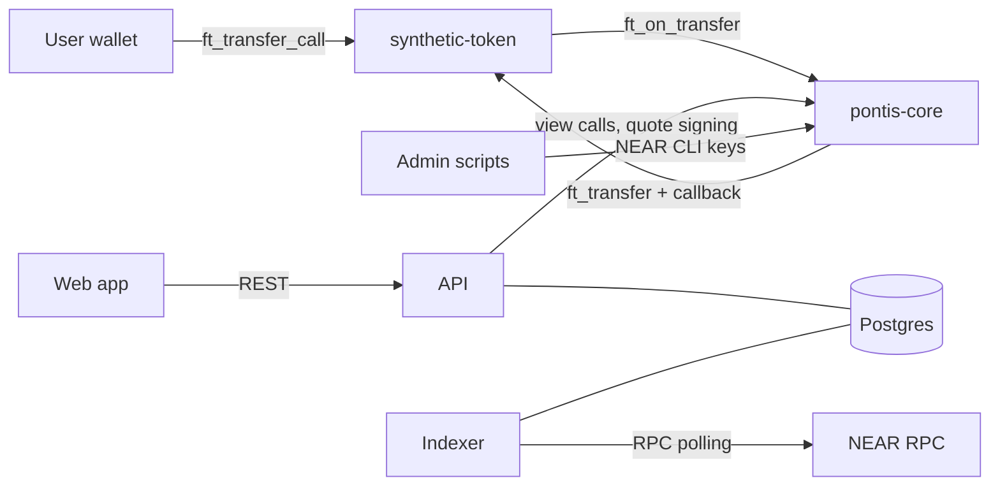

# MVP threat model

- **Status:** Draft v1 (Phase 0 exit criterion, brief §18.3, §16.2)
- **Date:** 2026-11-07
- **Scope:** testnet MVP with synthetic assets only. Nothing here authorises use with real assets or funds; see [ADR 0010](../decisions/0010-deferred-scope.md).
- **Related:** [ADR 0002](../decisions/0002-contract-layout-and-events.md), [0003](../decisions/0003-admin-roles-and-pause.md), [0006](../decisions/0006-quote-signing-model.md), [0007](../decisions/0007-conversion-via-ft-transfer-call.md), [0008](../decisions/0008-vault-inventory-and-funding.md)

## 1. Assets to protect

| Asset                             | Why it matters                                                        |
| --------------------------------- | --------------------------------------------------------------------- |
| Vault inventory in `pontis-core`  | Pays out conversions. Drain is the main fund-loss path.               |
| User tokens in flight             | Held by `pontis-core` between `ft_on_transfer` and payout resolution. |
| Compatibility and policy state    | Wrong approval means a false equivalence.                             |
| Quote-signer key                  | Authenticates quotes.                                                 |
| Admin and deployer keys           | Control roles, fees, withdrawal and redeploy.                         |
| Accounting integrity (events, DB) | History and reconciliation must match the chain.                      |
| Honest labelling                  | Users must not believe the assets are real or verified.               |

## 2. Actors and trust boundaries

| Boundary                 | Trust assumption                                                                                                                                              |
| ------------------------ | ------------------------------------------------------------------------------------------------------------------------------------------------------------- |
| User wallet to chain     | The user's wallet is the only authority over the user's tokens. The backend never holds user keys.                                                            |
| API to chain             | The API is trusted to run off-chain pre-checks and sign quotes, but **not** trusted for amounts, status or eligibility: the contract re-validates everything. |
| Web app to API           | Untrusted client. All input is validated.                                                                                                                     |
| Indexer to DB            | Trusted to apply chain events faithfully; the DB is a cache of the chain, never the authority.                                                                |
| Admin scripts            | Run by the operator with NEAR CLI credentials outside the API.                                                                                                |
| NEAR RPC                 | A single RPC provider may lie, lag or fail; finality window and re-scans mitigate.                                                                            |
| Synthetic token contract | Trusted only through the registry; `pontis-core` accepts `ft_on_transfer` only from registered active representations.                                        |

## 3. Threats and mitigations

Severity is for the MVP's testnet context. "Residual" is what remains after the planned mitigation.

| #   | Threat                                                                                                                                                                                                                         | Sev    | Mitigation                                                                                                                                                                                                                                                                                                                                                                                                 | Residual                                                                                                                                                                                                           |
| --- | ------------------------------------------------------------------------------------------------------------------------------------------------------------------------------------------------------------------------------ | ------ | ---------------------------------------------------------------------------------------------------------------------------------------------------------------------------------------------------------------------------------------------------------------------------------------------------------------------------------------------------------------------------------------------------------- | ------------------------------------------------------------------------------------------------------------------------------------------------------------------------------------------------------------------ |
| T1  | **Quote-signer compromise.** Attacker signs quotes freely.                                                                                                                                                                     | Med    | Contract recomputes amounts and re-checks status, pauses, allowlist, inventory ([ADR 0006](../decisions/0006-quote-signing-model.md)). Rotate with `set_quote_signer`. Key only in env, never in git or logs.                                                                                                                                                                                              | Attacker can authorise valid conversions without API pre-checks and rate limits. Cannot exceed ratio or spend user funds.                                                                                          |
| T2  | **Quote replay.** Reuse a signed quote.                                                                                                                                                                                        | High   | Nonce / operation ID marked used before payout and kept used after failure. Contract account, user, tokens and expiry are in the signed payload.                                                                                                                                                                                                                                                           | Nonce set grows without pruning (testnet only).                                                                                                                                                                    |
| T3  | **Altered quote.** User edits amounts or fee in `msg`.                                                                                                                                                                         | High   | Signature covers every field; contract also recomputes output.                                                                                                                                                                                                                                                                                                                                             | None expected; covered by negative tests.                                                                                                                                                                          |
| T4  | **Expired quote executed.**                                                                                                                                                                                                    | High   | `now_ms < expires_at_ms` enforced in `ft_on_transfer`. API sets 60 s expiry.                                                                                                                                                                                                                                                                                                                               | Validator clock skew of seconds.                                                                                                                                                                                   |
| T5  | **Vault drain by rounding or dust splitting.**                                                                                                                                                                                 | High   | `floor` on gross, `ceil` on fee; `net <= gross <= exact`. Property tests for the invariant ([ADR 0001](../decisions/0001-synthetic-claim-and-units.md)). Checked arithmetic.                                                                                                                                                                                                                               | None expected.                                                                                                                                                                                                     |
| T6  | **Vault drain by admin key.** Owner withdraws inventory.                                                                                                                                                                       | High   | Owner-only, evented, visible to reconciler.                                                                                                                                                                                                                                                                                                                                                                | Single owner key on testnet. Multisig is a precondition for non-testnet use.                                                                                                                                       |
| T7  | **Fake token calls `ft_on_transfer`.**                                                                                                                                                                                         | High   | `predecessor_account_id` must be a registered active representation.                                                                                                                                                                                                                                                                                                                                       | None expected.                                                                                                                                                                                                     |
| T8  | **Unauthorised credit to vault inventory.**                                                                                                                                                                                    | Med    | `fund_vault` honoured only for `owner`; other senders refunded. Plain `ft_transfer` is not credited and is flagged by reconciliation.                                                                                                                                                                                                                                                                      | Stranded tokens until owner recovery.                                                                                                                                                                              |
| T9  | **Stale or wrong compatibility.** False equivalence, or relationship should be suspended.                                                                                                                                      | High   | Quote- and execution-time checks of status and `version`. Suspension is immediate by `pauser` or `compat_approver`. History is append-only.                                                                                                                                                                                                                                                                | Staleness is not auto-detected; relies on operator review.                                                                                                                                                         |
| T10 | **Compatibility approved by the same account that proposed it.**                                                                                                                                                               | Med    | Both accounts recorded in history.                                                                                                                                                                                                                                                                                                                                                                         | Not enforced on-chain ([ADR 0003](../decisions/0003-admin-roles-and-pause.md)); accepted for testnet.                                                                                                              |
| T11 | **Ratio typo at approval.**                                                                                                                                                                                                    | High   | Contract rejects an approved ratio that differs from the multiplier-derived ratio.                                                                                                                                                                                                                                                                                                                         | Multiplier itself could be wrong; checked by dossier review.                                                                                                                                                       |
| T12 | **Pause bypass.**                                                                                                                                                                                                              | High   | Pause flags checked in every state-changing path; only `owner` unpauses.                                                                                                                                                                                                                                                                                                                                   | None expected.                                                                                                                                                                                                     |
| T13 | **Reentrancy / callback ordering.** State changed after a promise.                                                                                                                                                             | High   | State, nonce and inventory are updated before promise creation; callback only reverses on failure.                                                                                                                                                                                                                                                                                                         | Cross-shard receipt ordering: integration tests on sandbox (B8).                                                                                                                                                   |
| T14 | **Payout fails after input taken.**                                                                                                                                                                                            | High   | Callback restores inventory and returns `amount_in` unused so the token refunds the user; emits `conversion_failed`.                                                                                                                                                                                                                                                                                       | Token-level refund logic is trusted (NEP-141 standard).                                                                                                                                                            |
| T15 | **Unregistered receiver storage on token_out.**                                                                                                                                                                                | Low    | Payout failure refunds input; API plan includes `storage_deposit`.                                                                                                                                                                                                                                                                                                                                         | Gas cost to user on failed attempt.                                                                                                                                                                                |
| T16 | **Faucet abuse.** Mint spam.                                                                                                                                                                                                   | Low    | Per-call cap and per-account cooldown; owner can disable.                                                                                                                                                                                                                                                                                                                                                  | Sybil accounts can still collect small amounts of worthless tokens. Faucet does not fund the vault.                                                                                                                |
| T17 | **Eligibility bypass.**                                                                                                                                                                                                        | Med    | Allowlist checked at quote and live at execution.                                                                                                                                                                                                                                                                                                                                                          | Allowlist is not KYC ([ADR 0005](../decisions/0005-allowlist-eligibility.md)).                                                                                                                                     |
| T18 | **Indexer divergence.** Reorg, duplicate or missed events.                                                                                                                                                                     | Med    | Unique on `(receipt_id, log_index)`, persisted cursor, finality-window re-scan, retry with backoff (B12).                                                                                                                                                                                                                                                                                                  | Brief display lag during RPC outages.                                                                                                                                                                              |
| T19 | **API or DB tampering shows wrong state.**                                                                                                                                                                                     | Med    | Chain is authoritative; reconciler compares DB, events and token balances and flags `REQUIRES_RECONCILIATION` (B13).                                                                                                                                                                                                                                                                                       | Operator must act on flags.                                                                                                                                                                                        |
| T20 | **API abuse.** Quote spam, brute force on admin endpoints.                                                                                                                                                                     | Med    | Per-client rate limits by class (reads 120, writes 30, admin 10 per minute), body cap 16 KiB, schema validation, admin key compared in constant time, CORS to the web origin ([ADR 0013](../decisions/0013-api-hardening.md)).                                                                                                                                                                             | Distributed abuse and several API instances sharing no counters are out of scope for testnet.                                                                                                                      |
| T21 | **Secret leakage via logs or errors.**                                                                                                                                                                                         | Med    | Log scrubbing; structured errors without internals; signer key and admin key only in env ([BuildPlan §11](../../BuildPlan.md)).                                                                                                                                                                                                                                                                            | Operator mistakes in env handling.                                                                                                                                                                                 |
| T22 | **Misleading UI.** Users believe assets are real, "verified" or bridged.                                                                                                                                                       | Med    | Synthetic and unverified flags are data ([ADR 0009](../decisions/0009-synthetic-evidence-labelling.md)); language rules enforced in review.                                                                                                                                                                                                                                                                | None expected.                                                                                                                                                                                                     |
| T23 | **Wrong-network use.** User transacts on mainnet.                                                                                                                                                                              | Low    | Web network guard, testnet-only config, no mainnet contracts.                                                                                                                                                                                                                                                                                                                                              | None expected.                                                                                                                                                                                                     |
| T24 | **Gas underestimate.** Callback fails to run, leaving state inconsistent.                                                                                                                                                      | Med    | Gas measured in sandbox tests and returned in the plan; reconciler flags stuck `SUBMITTED` quotes.                                                                                                                                                                                                                                                                                                         | Gas changes after protocol upgrades.                                                                                                                                                                               |
| T25 | **Reversed ratio.** A route used in the `b to a` direction applies the `a to b` ratio.                                                                                                                                         | High   | `get_route` inverts the stored ratio by direction; tests cover both directions ([ADR 0004](../decisions/0004-compatibility-and-policy-versioning.md)).                                                                                                                                                                                                                                                     | None expected.                                                                                                                                                                                                     |
| T26 | **Evidence swapped after approval.** Evidence is added to an approved relationship without a new review.                                                                                                                       | Low    | Evidence records adder, time and hash and emits `evidence_added`; it is not versioned, so it never changes what was approved.                                                                                                                                                                                                                                                                              | A reviewer must read the event stream to notice late evidence.                                                                                                                                                     |
| T27 | **Policy no-op voids quotes.** Repeated rule changes bump `policy_version` and invalidate every quote.                                                                                                                         | Low    | Setting a rule to its current value is rejected; membership changes never bump the version ([ADR 0004](../decisions/0004-compatibility-and-policy-versioning.md)).                                                                                                                                                                                                                                         | A registrar can still toggle a rule on purpose.                                                                                                                                                                    |
| T28 | **Dust conversion.** An input converts to zero output and is taken.                                                                                                                                                            | Low    | Zero-output conversions are refused (`AMOUNT_TOO_SMALL`) and the input is returned ([ADR 0007](../decisions/0007-conversion-via-ft-transfer-call.md)).                                                                                                                                                                                                                                                     | None expected.                                                                                                                                                                                                     |
| T29 | **Failed vault withdrawal loses inventory accounting.**                                                                                                                                                                        | Med    | Inventory is debited first and restored by `on_withdraw_resolved`; `vault_withdrawn.success` records the outcome ([ADR 0008](../decisions/0008-vault-inventory-and-funding.md)).                                                                                                                                                                                                                           | Callback gas is measured in the sandbox (B8) and has headroom.                                                                                                                                                     |
| T30 | **Signer mismatch.** The API signs with a key the contract does not trust (after a rotation or a wrong env), so every conversion is refused.                                                                                   | Low    | Start-up comparison of the derived public key with `get_quote_signer`; a warning is logged. Rotation is `set_quote_signer` plus the new secret in the API env ([ADR 0006](../decisions/0006-quote-signing-model.md)).                                                                                                                                                                                      | Quotes issued before the rotation fail on-chain (by design).                                                                                                                                                       |
| T31 | **Double accept or key reuse.** Two clients accept one quote, or one client replays a request, to obtain conflicting plans.                                                                                                    | Low    | One transaction moves the quote to `ACCEPTED` and inserts the conversion; a unique constraint on the quote allows a single winner; the Idempotency-Key replays the stored plan ([ADR 0007](../decisions/0007-conversion-via-ft-transfer-call.md)). The contract still enforces the nonce.                                                                                                                  | A user who holds a quote ID can see its plan (the quote ID is an unguessable UUID).                                                                                                                                |
| T32 | **Forged settlement.** A fake event makes a conversion look settled or failed.                                                                                                                                                 | Medium | Only logs of successful receipts addressed to the core account count, and logs come from execution outcomes proven against a final light-client head, not from a user. Another contract cannot log as the core. A completion whose user or amounts differ from the quote goes to reconciliation instead of settling ([ADR 0011](../decisions/0011-indexer.md)).                                            | The indexer trusts its RPC node's proofs; it does not verify the light-client proof itself.                                                                                                                        |
| T33 | **Missed events.** The indexer is down or its node forgets blocks, so a conversion never settles in the database.                                                                                                              | Medium | The cursor is persisted and each block is atomic. Restarts re-read recent blocks. Lost history raises an error rather than skipping. `GET /v1/health` shows the lag and flags a silent indexer as `stale`.                                                                                                                                                                                                 | Past the node's retention a gap needs an archival node or a manual cursor reset.                                                                                                                                   |
| T34 | **Executed behind the API's back.** The chain runs a quote the API marked `QUOTED` or `EXPIRED` (a client using the quote without accepting it, or a deadline race).                                                           | Low    | The quote moves to `REQUIRES_RECONCILIATION` with an audit row; funds already moved on chain, so the state, not the funds, is what is corrected.                                                                                                                                                                                                                                                           | Until reconciled, the user sees a non-final state.                                                                                                                                                                 |
| T35 | **Silent vault shortfall.** Inventory exceeds the tokens the core holds, so a payout would fail or the vault is drained outside the contract.                                                                                  | High   | The reconciler compares `get_inventory` with `ft_balance_of(pontis-core)` for every representation each minute and reports `VAULT_INSOLVENT` as critical on the second sighting ([ADR 0012](../decisions/0012-reconciliation.md)).                                                                                                                                                                         | Detection, not prevention; up to two runs of delay.                                                                                                                                                                |
| T36 | **Lost or stuck conversion.** A reported transaction never settles in the database.                                                                                                                                            | Medium | A quote `SUBMITTED` with no outcome event after 10 minutes moves to `REQUIRES_RECONCILIATION` with an audit row, and shows in `GET /v1/admin/reconciliation`. It settles itself if the event arrives later.                                                                                                                                                                                                | Resolving a flagged quote that never settles is manual until an admin action exists (B14).                                                                                                                         |
| T37 | **Admin data exposed.** Someone reads reconciliation findings or vault balances.                                                                                                                                               | Low    | The endpoint needs `Authorization: Bearer <ADMIN_API_KEY>`, compared in constant time, and refuses everyone when no key is set. The data is testnet inventory only.                                                                                                                                                                                                                                        | One shared key, no per-admin identity or rate limit until B14.                                                                                                                                                     |
| T38 | **Secrets in logs.** The signer key, admin key or database password reach a log line through an error message or a logged header.                                                                                              | Medium | Request logs hold only method and path; error text and stacks are scrubbed of ed25519 keys, bearer tokens and connection-string credentials; header redaction as a backstop. Tests make a failing request carry each secret and search the output.                                                                                                                                                         | A secret in a shape the scrubber does not know would pass; the scrubber is a second line, not the only one.                                                                                                        |
| T39 | **Unaccountable admin use.** An admin read, or guesses at the key, leave no trace.                                                                                                                                             | Low    | Every admin call writes an audit row, under a fingerprint of the key or `anonymous`, without the key or the caller's address.                                                                                                                                                                                                                                                                              | One shared key identifies a key, not a person.                                                                                                                                                                     |
| T40 | **Registry metadata mistaken for verification.** An evidence URI, hash, provenance label, `controlled_accounts` entry or `*_attested` status is read as proof that an asset exists, is authorized or was checked.              | Med    | The contract enforces issuer category and account lists, refuses `independently_verified`, and documents every other field as a recorded claim ([ADR 0009](../decisions/0009-synthetic-evidence-labelling.md) amendment, [known limitations](../known-limitations.md)).                                                                                                                                    | Evidence content and account control are not authenticated. Fine for synthetic assets; real RWAs need attested issuers, account-control proof and role separation first.                                           |
| T41 | **Simulated market data read as real.** A price, NAV, supply, volume or chart from the demo simulator is shown, quoted or exported as if it were a market observation, or real and simulated rows are blended into one figure. | Med    | Every market row stores `source` and `simulated`; aggregates (candles, stats) are computed per data class and never blend them; every API figure, chart envelope and chart point carries `simulated` and `sources`; `data=real\|simulated\|all` is explicit; the frontend handoff requires a visible badge ([ADR 0015](../decisions/0015-market-data-platform.md), [handoff](../api/FRONTEND_HANDOFF.md)). | The flag protects only a client that renders it. A screenshot or an export that drops the badge loses the label; the simulated attestations are signed with a published dev key and prove nothing about any price. |
| T42 | **Price publisher key compromise.** An attacker signs prices that trip breakers, hide a real deviation or open a guarded route at the wrong price.                                                                             | High   | Prices are signed by registered keys only; a price must be strictly newer than the stored one, at most 60 s ahead and at most `2^64 - 1`; staleness and deviation are bounded on chain per pair; the owner removes a key with `remove_price_publisher_key`; several keys may be registered for overlap ([ADR 0016](../decisions/0016-price-reference-and-route-guards.md)).                                | The contract bounds a price, it cannot know it is true. A key held by one party in the demo is a single point of trust; threshold publishers and KMS are phase 7.                                                  |
| T43 | **Breaker griefing.** Someone trips a circuit breaker to deny service by spamming refused conversions or feeding a bad price.                                                                                                  | Med    | A refused conversion counts only while the price already deviates; a trip needs `trip_after` consecutive violating evaluations or the hard bound; a reset needs a second approver and a passing guard.                                                                                                                                                                                                     | A real price move trips the breaker by design. An attacker who controls a publisher key can trip it at will (T42).                                                                                                 |
| T44 | **Adverse selection through a stale ratio.** A route converts at an approved ratio while the market has moved, draining one vault.                                                                                             | High   | The deviation guard, per-transaction and window limits, the minimum size and the skew fee that rises as a vault drains; `fail_closed` when a price is stale.                                                                                                                                                                                                                                               | A pair with no guard behaves as in the MVP. Limits are tumbling windows, so up to twice the limit passes across a boundary. The skew is a deterrent, not a guarantee.                                              |

## 4. Admin keys

| Key                                | Held by                                  | Used for                                                           | Controls                   |
| ---------------------------------- | ---------------------------------------- | ------------------------------------------------------------------ | -------------------------- |
| Owner / deployer                   | Operator, NEAR CLI credentials           | Roles, signer, fees, vault funding and withdrawal, unpause, deploy | Everything on the contract |
| Registrar, compat approver, pauser | Operator on testnet (may be one account) | Scripted admin actions                                             | Only their role            |
| Quote-signer                       | API environment                          | Signing quotes                                                     | Quote authenticity only    |
| Token owners (TGOLD-A, TGOLD-B)    | Operator                                 | Mint, burn, pause, faucet config                                   | Token supply               |

Rules: no key is stored in git; `.env*` and `.near-credentials` are ignored; the API holds only the quote-signer key; any non-testnet use requires multisig and key-lockdown design first.

## 5. Accepted MVP limitations

- Single operator may hold every role; proposer/approver separation not enforced on-chain.
- No automatic staleness expiry for relationships.
- Nonce set and relationship history are unpruned.
- No external audit, no formal verification, no production monitoring or backups.
- Testnet RPC and explorer availability are outside our control.
- A transaction hash reported by a wallet is checked against the configured RPC node before the API shows it as `txHash` (signer, token, `ft_transfer_call` arguments, quote nonce, settlement receipt). The node is trusted and no light-client proof is checked; a conversion nobody reports has no hash.

## 6. Verification plan

- Contract negative tests for T2–T4, T7–T8, T12, T14 (BuildPlan B6–B8).
- Hash verification tests cover forged, foreign and unrelated hashes, an unreachable node, and both orders of report and settlement (`apps/api/test/submit-verification.test.ts`, `apps/indexer/test/verify-hashes.test.ts`, `packages/near-client/test/transaction*.test.ts`).
- B14 tests cover T20, T38 and T39: rate limits per class and client, CORS and headers, log scrubbing and the admin audit trail (`apps/api/test`).
- B13 tests cover T35 to T37: vault mismatches with the two-sighting rule, stuck and inconsistent settlements, and admin key checks (`apps/indexer/test/reconciler-*.test.ts`, `apps/api/test/admin*.test.ts`).
- B12 tests cover T32 to T34: failed receipts ignored, mismatched completions, duplicates, restart and lost history (`apps/indexer/test`).
- B11 tests cover T31: concurrent accepts, idempotent replay and expiry (`apps/api/test/accept.test.ts`).
- B10 tests cover quote refusals, nonce uniqueness, expiry and the signing vector shared with the contract (T2, T3, T4, T30).
- B7 tests cover T2 to T5, T7, T8, T12 and T28 to T29 at unit level (`cargo test -p pontis-core`); T13 and T14 need the sandbox (B8).
- B6 tests cover T9 to T11 (suspension, re-approval, ratio and evidence checks), T25 and T27: `cargo test -p pontis-core`.
- Property tests (proptest) for T5 using shared Rust and TypeScript vectors (B7, B10).
- Sandbox integration tests cover T13, T14 and T24 (B8): `scripts/integration-tests.sh`; they also cover T2, T3, T4, T7 and T8 against the real token.
- Indexer tests for T18; reconciler injected-mismatch tests for T19 (B12–B13).
- API authorization and rate-limit tests for T20 (B14).
- This document is revisited at the end of B8 and again before B15.
